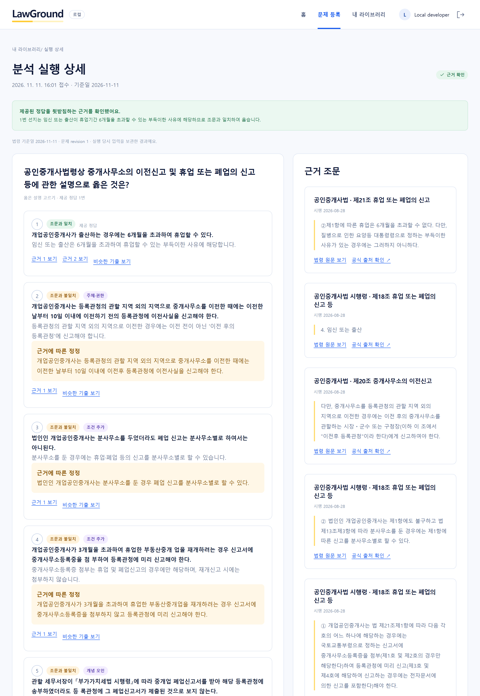
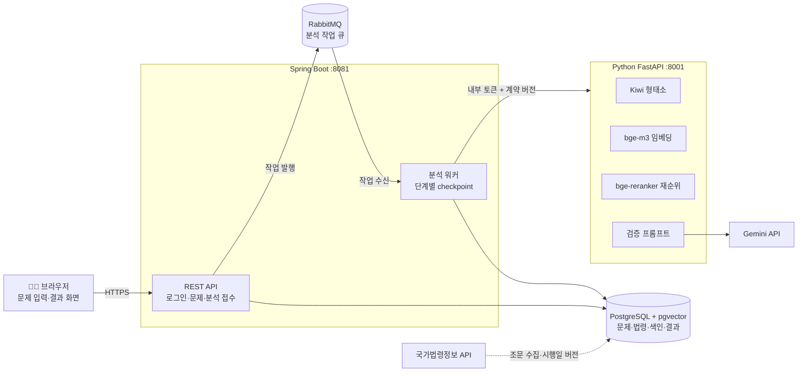
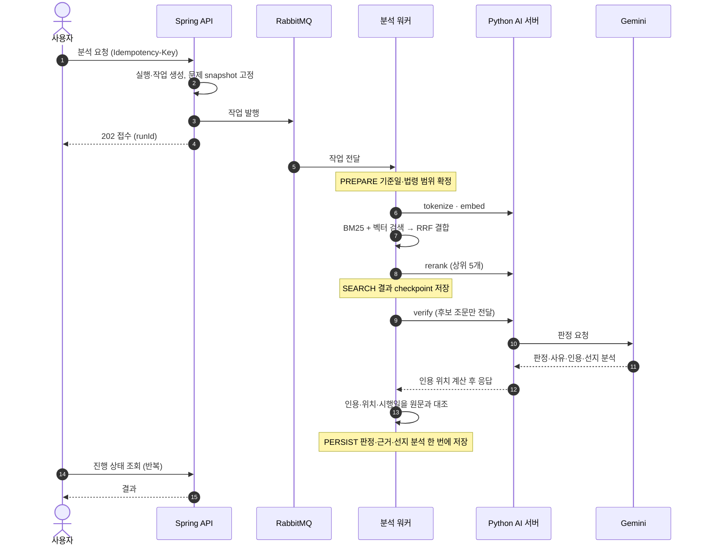
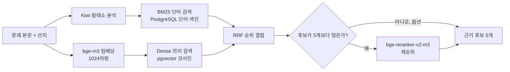
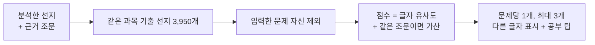
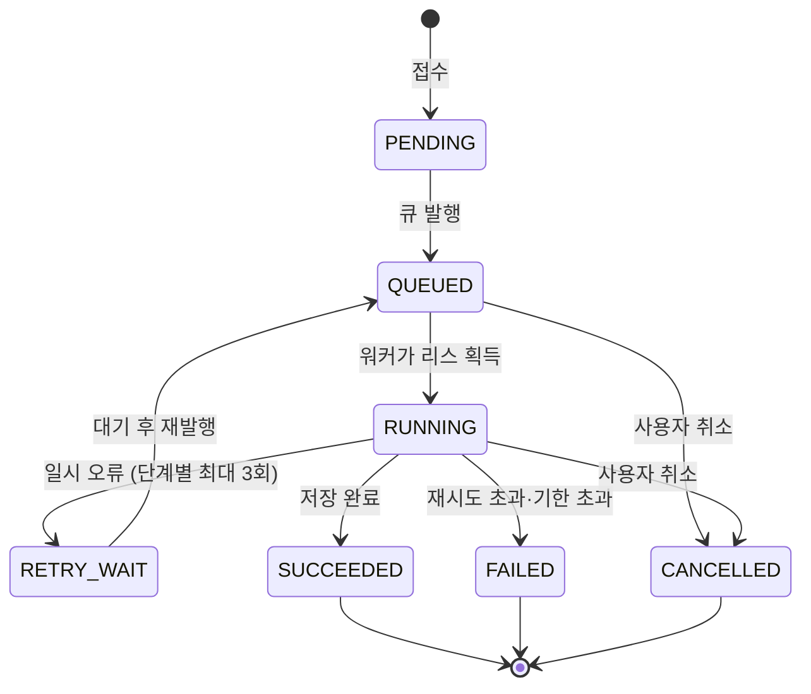
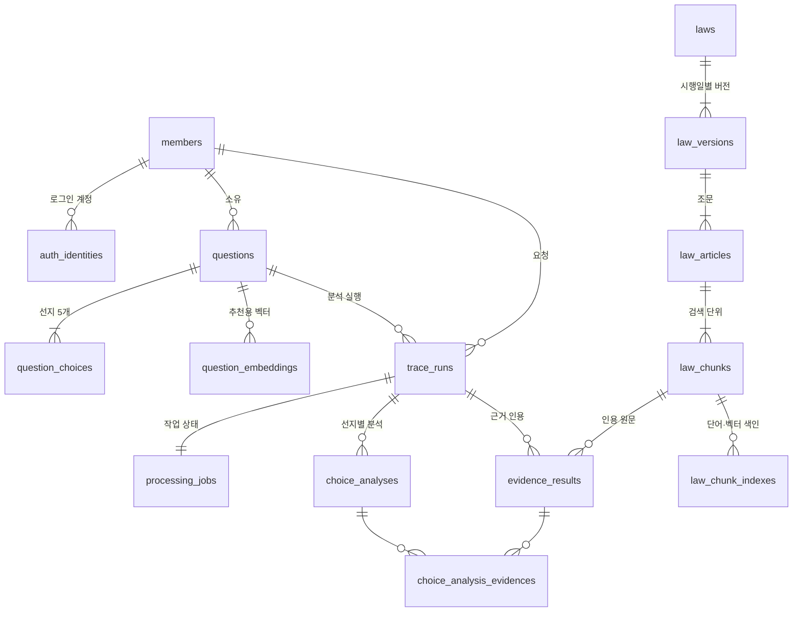
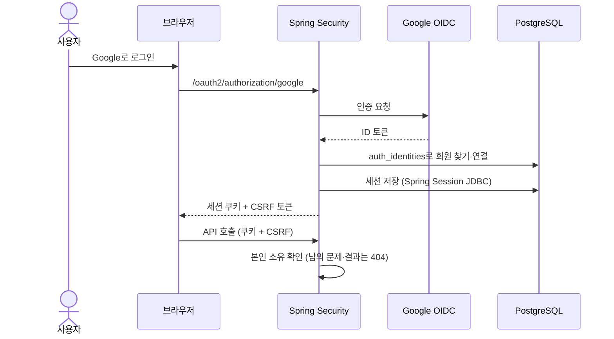
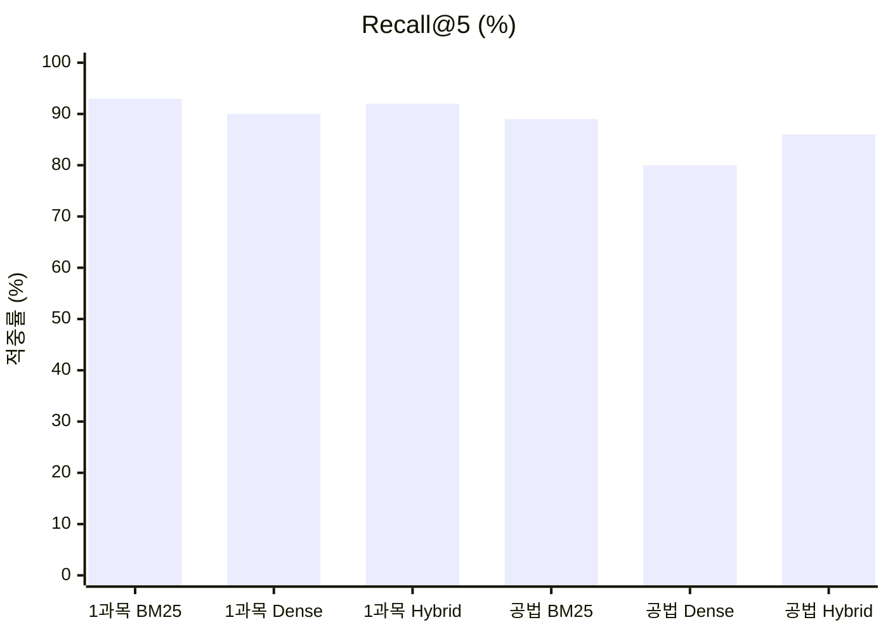

<div align="center">

# ⚖️ LawGround

**기출 선지 하나를 넣으면, 현행 법령에서 근거 조문을 찾아 정답을 검증합니다**

공인중개사 기출 선지의 법령 근거 검색·검증 서비스

[](https://github.com/lawground-team/LawGround/actions/workflows/ci.yml)


<!-- TODO: 결과 화면 캡처를 docs/images/result.png 로 넣고 아래 주석을 푼다 -->
<!--  -->

</div>

---

## 목차

1. [서비스 소개](#1-서비스-소개)
2. [팀 소개](#2-팀-소개)
3. [개발 배경](#3-개발-배경)
4. [개발 목표](#4-개발-목표)
5. [개요와 주요 기능](#5-개요와-주요-기능)
6. [시스템 구조](#6-시스템-구조)
7. [분석 파이프라인](#7-분석-파이프라인)
8. [백엔드 구조](#8-백엔드-구조)
9. [프로젝트 구조](#9-프로젝트-구조)
10. [데이터](#10-데이터)
11. [성능](#11-성능)
12. [이용 방법](#12-이용-방법)
13. [기술 스택](#13-기술-스택)
14. [테스트와 CI](#14-테스트와-ci)
15. [제출 자료](#15-제출-자료)
16. [AI 코딩 도구 활용](#16-ai-코딩-도구-활용)
17. [한계와 향후 과제](#17-한계와-향후-과제)
18. [출처와 저작권](#18-출처와-저작권)
19. [문서 모음](#19-문서-모음)

---

## 1. 서비스 소개

공인중개사 수험생이 기출 문제와 선지, 정답 번호를 입력하면 LawGround가 세 가지를 해 줍니다.

1. **검색** — 국가법령정보센터의 현행 조문 2,400여 개 중에서 근거 후보 5개를 찾습니다.
2. **검증** — LLM이 그 후보 조문 **안에서만** 정답이 맞는지 판정하고, 인용 문구가 원문과 글자 단위로 같은지 다시 확인합니다.
3. **설명** — 선지마다 조문과 일치·불일치를 보여 주고, 틀린 선지는 고친 문장과 변형 유형, 같은 조문을 다룬 비슷한 기출을 보여 줍니다.

| 근거 조문 검색 (상위 5개 적중) | | 판정 시험 | 실제 연결 시험 |
|:---:|:---:|:---:|:---:|
| **93%** | **89%** | **0건** | **5/5** |
| 1과목 337문제 | 부동산공법 465문제 | 틀린 답을 맞다고 승인 | 연속 분석 성공 (평균 95초) |

> 25~36회 공인중개사 2차 1교시 기출 기준. 자세한 조건은 [11. 성능](#11-성능) 참고.

## 2. 팀 소개

| 항목 | 내용 |
|---|---|
| 팀명 | `TODO` |
| 과목 | 2026 캡스톤디자인 (단국대학교 소프트웨어학과) |
| 지도교수 | `TODO` |

| 이름 | 학번 | 역할 | 담당 |
|---|---|---|---|
| 임수종 | `TODO` | AI·검색·평가 | Python AI 서버(형태소·임베딩·재순위·검증), 법령 수집 변환, 평가 데이터셋·라벨·지표, 확장 기능(문장 확인·비슷한 기출) |
| 윤영주 | `TODO` | 백엔드·파이프라인·화면 | Spring 백엔드, 로그인·문제 관리, 분석 작업 큐·워커, 검색·검증 연결과 결과 저장, 추천·평가·배치, 사용자 화면 |

## 3. 개발 배경

- **조문 찾기가 오래 걸린다.** 공인중개사법령과 부동산공법은 조문을 그대로 묻는 문제가 대부분이라, 선지 하나를 확인하려면 법률·시행령·시행규칙을 오가며 조문을 찾아야 합니다.
- **법령은 계속 바뀐다.** 개정되면 과거 기출의 정답과 해설이 현행 법령과 어긋나는데, 수험생이 이를 스스로 가려내기 어렵습니다.
- **LLM은 그럴듯하게 틀린다.** 범용 챗봇은 근거 없이 그럴듯한 답(환각)을 낼 수 있고, 법률 공부에서는 틀린 내용을 맞다고 하는 것이 가장 위험합니다.

## 4. 개발 목표

| 목표 | 기준 |
|---|---|
| 근거를 찾는다 | 정답 근거 조문이 검색 상위 5개 안에 들어 있을 것 |
| 틀린 답을 승인하지 않는다 | 근거가 부족하면 단정하지 않고 **판단 보류** |
| 근거를 보여 준다 | 판정마다 원문 인용과 위치를 함께 제시하고, 인용이 원문과 다르면 저장하지 않음 |
| 기준일을 지킨다 | 사용자가 고른 기준일에 시행 중인 조문으로만 판정 |
| 공부로 이어진다 | 선지별 설명, 변형 유형 태그, 같은 조문의 비슷한 기출 |

## 5. 개요와 주요 기능

| 기능 | 설명 |
|---|---|
| 로그인 | Google 로그인, 세션 기반 인증 |
| 문제 입력 | 시험지 문장을 붙여넣으면 본문과 선지 5개로 자동 분리. 과목(1과목·부동산공법)과 기준일 선택 |
| 내 문제 라이브러리 | 문제 저장·수정·삭제, 수정 이력(revision) 관리 |
| 분석 진행 | 준비 → 검색 → 검증 → 저장 단계를 화면에서 실시간 표시. 새로고침해도 이어서 조회 |
| 판정 | **근거 확인**(SUPPORTED) · **근거와 불일치**(REJECTED) · **판단 보류**(HOLD) |
| 근거 조문 | 조문 원문, 인용 위치 강조, 시행일, 국가법령정보센터 링크 |
| 선지별 분석 | 일치·불일치·근거 부족, 틀린 선지의 고친 문장, 변형 유형 태그 5종 |
| 비슷한 기출 | 선지마다 같은 근거 조문을 다룬 기출 선지 최대 3개, 다른 글자 표시와 공부 팁 |
| 관련 문제 추천 | 근거 조문과 문제 임베딩이 비슷한 내 문제 |

**변형 유형 태그 5종:** 주체·권한 / 숫자·기간 / 조건·예외 / 효과·결과 / 절차·방법

<!-- TODO: 화면 캡처 (입력 → 진행 → 결과) 를 docs/images/ 에 넣고 아래에 표로 배치 -->

## 6. 시스템 구조



- Spring은 사용자 요청, 권한, 작업 상태, 저장을 맡고 Python 서버는 모델 계산만 맡습니다.
- 두 서버는 [내부 API 계약](docs/api/internal-api.md)(OpenAPI)으로 통신하고, 모든 요청에 내부 토큰과 계약 버전 헤더를 검사합니다.
- 모델은 커밋 해시로 버전을 고정하고, Spring이 시작할 때 Python 서버의 모델 버전과 대조합니다.

## 7. 분석 파이프라인

### 7.1 분석 단계



- 단계마다 checkpoint를 남겨, 중간에 실패해도 끝난 단계는 다시 계산하지 않습니다.
- 인용 문구가 원문의 그 위치와 다르거나, 기준일에 시행 중이 아닌 조문이면 결과를 저장하지 않습니다.

### 7.2 하이브리드 검색



- 기준일에 시행 중인 조문만 검색합니다.
- 공법처럼 법률 용어가 글자 그대로 맞아야 찾히는 과목에서는 단어 검색이 강하고, 표현이 바뀐 선지는 의미 검색이 보완합니다. 그래서 두 방식을 결합했습니다.
- 결합 후보가 5개 이하라 잘리는 것이 없으면 재순위를 생략하는 옵션이 있습니다(`LAWGROUND_ANALYSIS_LIVE_SKIP_RERANK_WITHOUT_CUT`).

### 7.3 비슷한 기출 찾기



LLM을 쓰지 않아 응답이 약 0.1초입니다. 같은 조문의 기출이 없고 문장도 충분히 비슷하지 않으면 억지로 채우지 않고 "찾지 못했어요"를 보여 줍니다.

## 8. 백엔드 구조

### 8.1 작업 상태와 재시도



| 장치 | 하는 일 |
|---|---|
| 멱등 키 | 같은 요청을 다시 보내도 분석이 두 번 만들어지지 않음 |
| 리스 + fencing token | 같은 작업을 두 워커가 동시에 처리하지 못하게 하고, 늦게 끝난 옛 워커의 저장을 거부 |
| 단계별 checkpoint | 실패 후 재개할 때 끝난 단계(검색 결과 등)를 재사용 |
| 복구 스케줄러 | 리스가 끊긴 작업, 발행이 안 된 작업을 다시 큐에 넣음 |
| 결과 불변 | 저장된 판정·근거는 DB 트리거로 수정·삭제 금지 |

### 8.2 데이터베이스 (주요 테이블)



- 스키마는 Flyway 마이그레이션 `V001`~`V010`으로 관리합니다([backend/src/main/resources/db/migration](backend/src/main/resources/db/migration)).
- 이 밖에 평가용(`golden_sets`, `golden_cases`, `evaluation_runs` 등), 기출 배치용(`batch_runs`, `batch_items`), 세션용(`SPRING_SESSION`) 테이블이 있습니다.

### 8.3 로그인과 권한



### 8.4 패키지 구성 (Spring)

| 패키지 | 역할 |
|---|---|
| `auth`, `member` | Google 로그인, 회원, 세션 |
| `question` | 문제·선지 저장, 수정 이력 |
| `trace`, `job` | 분석 실행, 작업 상태, 큐 발행·워커·복구 |
| `law` | 법령 버전·조문·검색 색인, 하이브리드 검색 |
| `integration` | Python AI 서버 HTTP 클라이언트, 법령 가져오기 |
| `recommendation` | 관련 문제 추천, 비슷한 기출 |
| `evaluation`, `batch` | 골든셋 평가, 기출 일괄 실행·집계 |
| `global` | 보안 설정, 공통 오류, 요청 ID |

## 9. 프로젝트 구조

```text
LawGround/
├── backend/                 Spring Boot 백엔드 (API·워커·DB 마이그레이션)
│   └── src/main/java/com/lawground/   패키지 구성은 8.4 참고
├── ai-service/              Python FastAPI AI 서버
│   ├── app/services/        tokenizer · embedder · reranker · verifier · statement · variation · similar
│   ├── app/contract/        내부 API 요청·응답 모델
│   ├── scripts/             평가·데이터 변환 도구 (기출 PDF 변환, Recall 계산, 판정 시험)
│   └── tests/               pytest
├── frontend/                프레임워크 없는 ES 모듈 화면 (Spring이 정적 파일로 제공)
├── docs/
│   ├── api/                 사용자·내부 API 계약 (OpenAPI)
│   ├── architecture/        설계 문서
│   ├── runbooks/            실행·운영 안내
│   ├── reports/             구현 보고서
│   └── development.md       개발 환경·검증 명령 모음
├── scripts/                 저장소 경계·계약 검사
├── infra/                   DB·프록시 설정
├── docker-compose.yml       PostgreSQL(pgvector) · RabbitMQ
└── .github/workflows/ci.yml CI
```

## 10. 데이터

### 10.1 법령 코퍼스

| 과목 | 법령 | 조문 수 |
|---|---|---|
| 1과목 공인중개사법령 및 실무 | 공인중개사법, 부동산 거래신고 등에 관한 법률 (각 법·시행령·시행규칙) | 267 |
| 2과목 부동산공법 | 국토계획법, 도시개발법, 도시정비법, 건축법, 주택법, 농지법 (각 법·시행령·시행규칙) | 2,155 (별표 106 포함) |

국가법령정보 API에서 받아 조문 단위로 나누고 시행일별 버전으로 저장합니다. 긴 별표는 여러 조각으로 나눕니다.

### 10.2 평가 데이터셋

| 항목 | 내용 |
|---|---|
| 범위 | 공인중개사 2차 1교시, 25~36회 (2014~2025, 12개 회차) |
| 전체 | 960문제 (1과목 480, 공법 480) |
| 평가 대상 | **802문제** (1과목 337, 공법 465) — 현행 법령만으로 판단할 수 있는 문제 |
| 정답 라벨 | 문제마다 "정답을 판단하는 데 필요한 조문" |
| 기출 선지 은행 | 3,950개 선지와 정오·근거 조문 (비슷한 기출 기능에 사용) |

**범위 밖으로 뺀 기준:** 판례·서식·다른 법률 소관 문제, 폐지된 제도, 개정으로 출제 당시 정답이 무효가 된 문제, 전항정답.

**라벨 작성과 검수**
- 라벨 초안은 AI가 BM25 후보를 참고해 만들었습니다.
- 1과목: 표본 20문제를 **사람이 검수**해 18 일치, 2건은 조문 추가.
- 공법: 표본 15문제를 **사람이 검수**해 15 모두 일치.
- 36회 공법은 글자 층이 없는 스캔본이라 페이지 이미지를 보고 40문제를 직접 판독해 입력했습니다.
- 검수하지 않은 나머지 라벨은 AI 초안입니다.

> 기출 원문·라벨·선지 은행은 저작권 때문에 저장소에 올리지 않았습니다. 받는 방법과 실행 방법은 [팀 전달 실행 가이드](docs/handoff/2026-11-09_영주_전달_실행가이드.md), 법령 출처는 [데이터 출처 안내](docs/runbooks/data-sources.md)를 참고하세요.

## 11. 성능

### 11.1 근거 조문 검색 정확도 (Recall@5)

정답 근거 조문이 검색 상위 5개 안에 드는 비율입니다. [ ]는 95% 신뢰구간입니다.

| 과목 | 문제 | BM25 (단어) | Dense (의미) | Hybrid (결합) |
|---|---:|---:|---:|---:|
| 1과목 | 337 | **0.93** [0.90, 0.95] | 0.90 [0.86, 0.92] | 0.92 [0.89, 0.94] |
| 부동산공법 | 465 | **0.89** [0.86, 0.92] | 0.80 [0.77, 0.84] | 0.86 [0.83, 0.89] |



- 근거가 여러 조문인 문제는 하나라도 상위 5개에 들면 맞힌 것으로 셌습니다. 전부 들어야 맞힌 것으로 세면 1과목 BM25 0.85·Hybrid 0.84, 공법 0.78입니다.
- 상위 10개 기준 1과목 Hybrid 0.97입니다.
- **발견:** 공법에서는 단어 검색이 의미 검색보다 9%p 높았습니다. "제2종일반주거지역"처럼 법률 용어가 글자 그대로 맞아야 찾히는 문제가 많기 때문입니다.

### 11.2 판정 능력

정답 조문이 후보에 있을 때 LLM(gemini-3.5-flash) 판정만 시험했습니다.

| 입력 | 1과목 | 공법 | 합계 |
|---|---|---|---|
| 정답 번호 | 16문제 중 근거 확인 16 | 5문제 중 근거 확인 4, 보류 1 | **21문제 중 근거 확인 20**, 보류 1 |
| 틀린 번호 | 11문제 중 불일치 10, 보류 1 | 5문제 중 불일치 4, 보류 1 | 16문제 중 불일치 14, 보류 2, **잘못 승인 0** |

무료 API 한도(하루 약 20회) 때문에 표본이 37문제로 작습니다.

### 11.3 실제 연결 시험

8GB RAM 노트북에서 Docker·Spring·Python 서버·Gemini를 모두 연결해 36회 5문제를 연속 분석했습니다.

| 문제 | 전체 | 검색 | 검증 | 판정 |
|---|---:|---:|---:|---|
| 36-01 | 96초 | 78초 | 12초 | 근거 확인 |
| 36-03 | 94초 | 77초 | 14초 | 근거 확인 |
| 36-12 | 107초 | 65초 | 39초 | 판단 보류 |
| 36-24 | 126초 | 102초 | 21초 | 판단 보류 |
| 36-27 | 52초 | 34초 | 15초 | 근거 확인 |

5문제 모두 성공, 재시도 0, 평균 95초입니다. 보류 2건은 정답 근거 조문 일부가 후보 5개에 없어서였고 잘못된 판정은 없었습니다. 전체 측정 기록은 [발표_측정결과.md](발표_측정결과.md)에 있습니다.

## 12. 이용 방법

### 12.1 화면 사용 순서

1. Google 계정으로 로그인합니다.
2. **문제 입력**에서 시험지 문장을 붙여넣으면 본문과 선지 5개가 채워집니다. 과목, 정답 번호, 기준일을 확인하고 저장합니다.
3. 문제 상세에서 **분석 시작**을 누르면 준비 → 검색 → 검증 → 저장 단계가 표시됩니다.
4. 결과에서 판정, 근거 조문 원문, 선지별 분석을 확인합니다.
5. 선지마다 **비슷한 기출 보기**를 눌러 같은 조문을 다룬 기출을 봅니다.

### 12.2 로컬 실행

필요한 것: Java 21, Docker Desktop, Python 3.11+, Gemini API 키(검증용)

```powershell
# 1) 환경변수 파일 (처음 한 번)
Copy-Item .env.example .env   # 비밀번호·키를 채운다

# 2) PostgreSQL · RabbitMQ
docker compose up -d --wait

# 3) Spring (http://localhost:8081)
cd backend
.\gradlew.bat bootRun --args="--spring.profiles.active=local"

# 4) Python AI 서버 (새 창, :8001)
cd ai-service
python -m venv .venv
.\.venv\Scripts\pip install -r requirements.txt -r requirements-models.txt
.\.venv\Scripts\Activate.ps1
# 환경변수 설정 후 서버 실행 — 자세한 순서는 아래 안내 참고
```

- 8GB RAM PC에서는 순서(Docker → Spring → Python)와 메모리 확보가 중요합니다. [시연 실행 순서](시연_실행순서.md)를 따르세요.
- 모델 서버 설정: [AI 서버 연결](docs/runbooks/ai-connection.md) · [검증 연결](docs/runbooks/verification.md)
- 개발 환경과 검증 명령: [docs/development.md](docs/development.md)

## 13. 기술 스택

| 영역 | 기술 |
|---|---|
| 백엔드 | Java 21, Spring Boot 3.5 (MVC · Security · OAuth2 Client · Session JDBC · AMQP · JPA · Flyway) |
| 데이터 | PostgreSQL 16 + pgvector 0.8, RabbitMQ 4.2 |
| AI 서버 | Python, FastAPI, kiwipiepy, BAAI/bge-m3, BAAI/bge-reranker-v2-m3, Gemini API |
| 화면 | HTML · CSS · ES 모듈 (프레임워크 없음) |
| 테스트 | JUnit 5, MockMvc, Testcontainers, pytest, Node 테스트 |
| 협업·배포 | GitHub Actions CI, Docker Compose, OpenAPI 계약 |

## 14. 테스트와 CI

PR과 main push마다 GitHub Actions가 다음을 검사합니다.

| 검사 | 내용 |
|---|---|
| backend-check | 저장소 검사(비밀값·기출 원문 등 올리면 안 되는 파일 차단), 포맷(spotless), 단위 테스트, Testcontainers 통합 테스트(실제 PostgreSQL·RabbitMQ·Flyway), JAR 빌드 |
| ai-check | pytest (계약·검증·검색 보조 기능) |
| contracts-check | 사용자·내부 OpenAPI 계약과 예시, 실제 응답 캡처 대조 |
| frontend-check | 화면 모듈 테스트 |
| browser-check | Playwright(Chromium)로 화면 흐름 검사 |

## 15. 제출 자료

| 자료 | 링크 |
|---|---|
| 📄 결과보고서 (PDF) | `TODO` docs/submission/결과보고서.pdf |
| 🖼️ 포스터 (PDF · PNG) | `TODO` docs/submission/포스터.pdf |
| 📊 발표자료 | `TODO` |
| 🎬 시연 영상 | `TODO` YouTube 링크 |

## 16. AI 코딩 도구 활용

학과 기준에 따라 AI 코딩 도구를 쓴 부분을 밝힙니다. 자세한 내역은 결과보고서의 "AI 코딩 도구 활용 내역"에 있습니다.

| 항목 | 내용 |
|---|---|
| 사용 도구 | Claude Code (Anthropic) `TODO 그 밖의 도구` |
| 활용 이유 | `TODO` |
| 활용 범위 | `TODO 영역별로 AI가 구현한 부분과 팀원이 직접 한 부분` |
| 원칙 | 설계(구조·단계·계약·평가 방법)는 팀이 정하고, AI가 만든 코드는 팀원이 읽고 테스트를 통과시킨 뒤 반영. 정답 라벨은 AI 초안만으로 확정하지 않음 |

AI가 함께 작성한 커밋에는 `Co-Authored-By: Claude` 표시가 있습니다.

## 17. 한계와 향후 과제

- **검색 누락** — 정답 조문이 후보 5개에 없으면 판단을 보류합니다. 근거가 여러 조문인 공법 문제는 모두 찾는 비율이 78%입니다.
- **표본 크기** — 판정 시험이 37문제라 신뢰구간이 넓습니다.
- **속도** — 노트북 CPU에서 한 문제에 1~2분 걸립니다. GPU 서버나 외부 재순위 API로 줄일 수 있습니다.
- **라벨 검수** — 사람 검수는 표본 35문제만 했습니다.
- **범위** — 판례·서식·다른 법률, 민법·세법 과목은 아직 지원하지 않습니다. 37회(2026) 기출은 최종정답 공개 후 추가할 예정입니다.

## 18. 출처와 저작권

- 본 기출문제의 저작권은 **한국산업인력공단(Q-Net)** 에 있으며, 출처를 밝히고 사용하였습니다. 입력 편의와 화면 구성을 위해 문제 내용을 일부 재가공했습니다(선지 분리, 표기 정리, 제36회 스캔본 재입력). 공단의 공식 문제와 다를 수 있습니다.
- 법령 원문은 **국가법령정보센터**(law.go.kr) Open API에서 받았습니다.
- 기출 원문, 정답 라벨, 기출 선지 은행은 재배포 문제로 이 공개 저장소에 올리지 않았습니다. 이 파일이 없으면 평가 스크립트와 "비슷한 기출" 기능은 동작하지 않습니다(분석 기능은 동작).
- 사용한 모델: [BAAI/bge-m3](https://huggingface.co/BAAI/bge-m3), [BAAI/bge-reranker-v2-m3](https://huggingface.co/BAAI/bge-reranker-v2-m3) (MIT·Apache 2.0 계열 공개 라이선스), Google Gemini API.

## 19. 문서 모음

| 분류 | 문서 |
|---|---|
| API 계약 | [사용자 API](docs/api/external-api.md) · [내부 API](docs/api/internal-api.md) · [0.2.0 확장 제안](docs/api/proposal-0.2.0-statement-and-similar.md) |
| 설계 | [백엔드](docs/architecture/backend.md) · [분석·검색](docs/architecture/analysis-search.md) · [인증](docs/architecture/authentication.md) · [문제 저장](docs/architecture/questions.md) |
| 실행 | [로컬 개발](docs/runbooks/local-development.md) · [AI 서버 연결](docs/runbooks/ai-connection.md) · [LIVE 검색](docs/runbooks/live-retrieval.md) · [검증](docs/runbooks/verification.md) · [분석 화면](docs/runbooks/analysis-ui.md) |
| 기능 | [선지 분석](docs/runbooks/choice-analysis.md) · [추천](docs/runbooks/recommendations.md) · [평가](docs/runbooks/evaluation.md) · [기출 배치](docs/runbooks/exam-batches.md) · [데이터 출처](docs/runbooks/data-sources.md) |
| 기록 | [측정 결과](발표_측정결과.md) · [시연 실행 순서](시연_실행순서.md) · [윤영주 구현 보고서](docs/reports/youngju-integrated-week-08.md) · [개발 안내](docs/development.md) |
