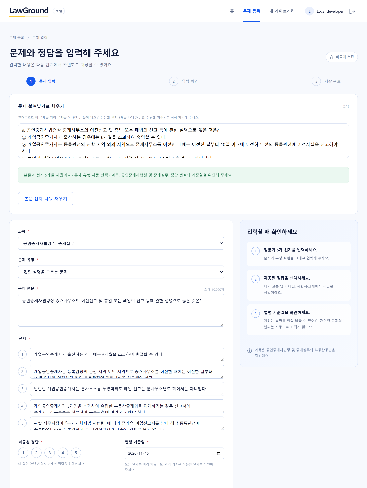
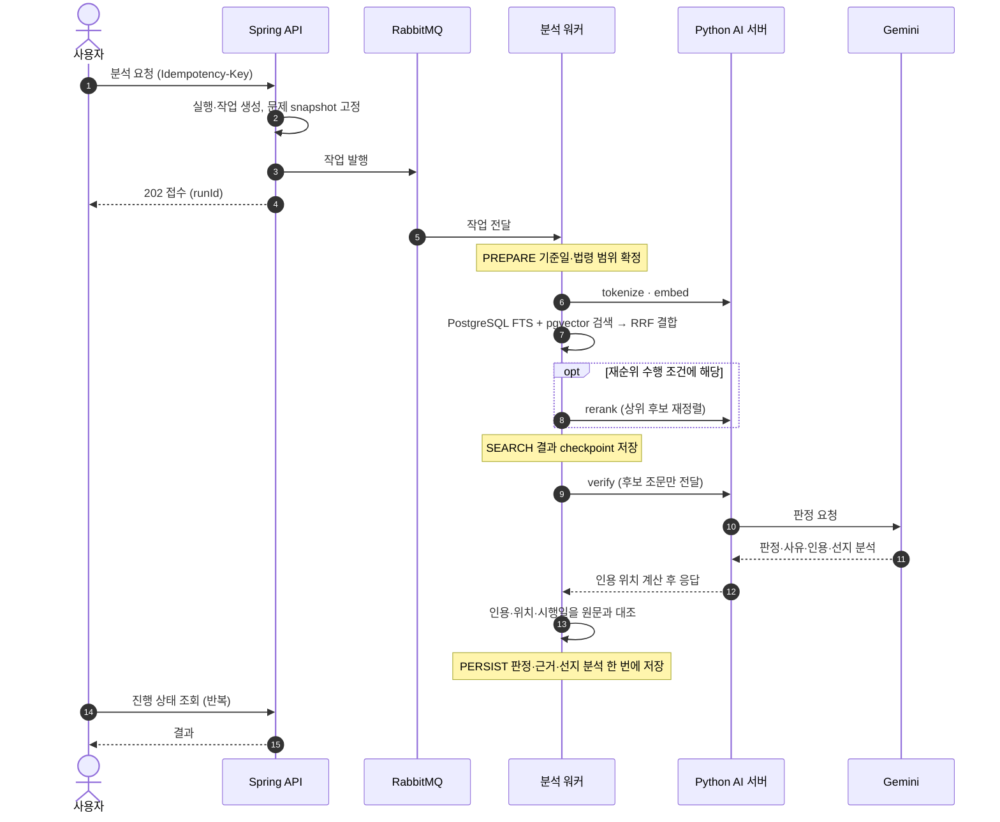
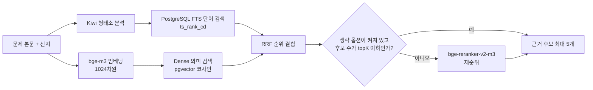
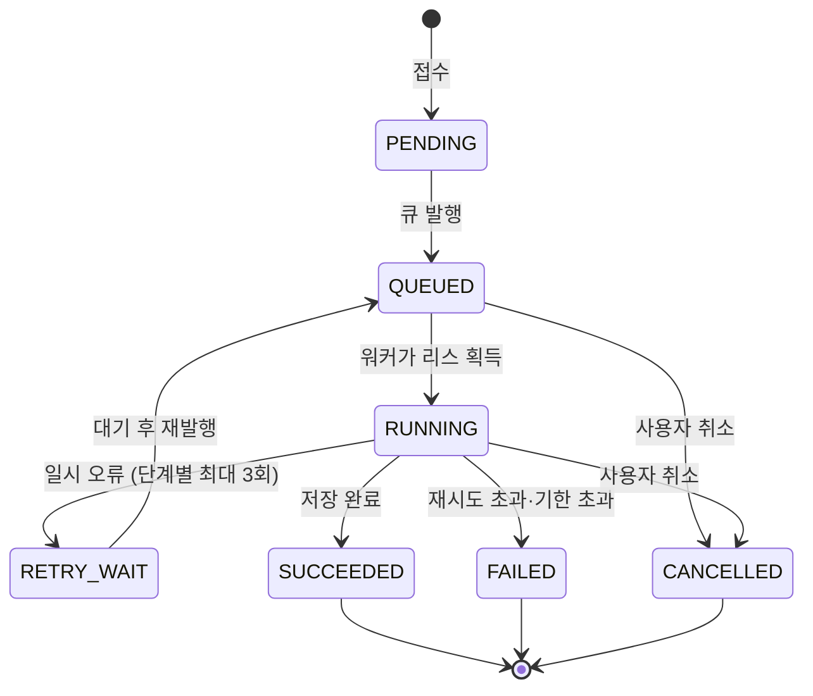
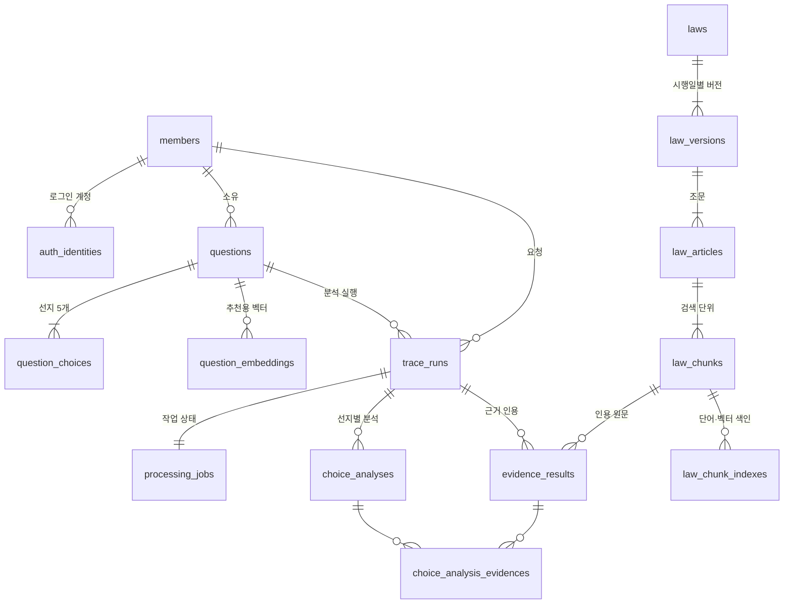
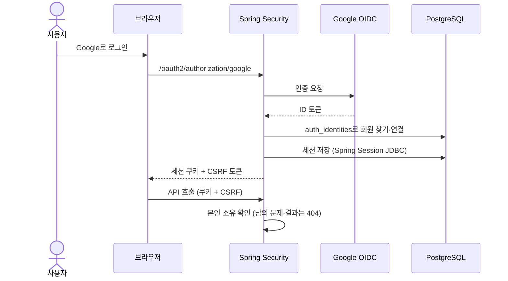
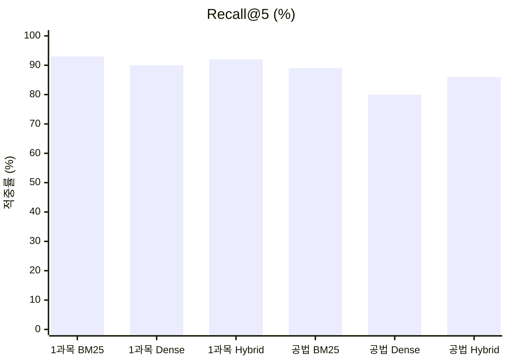

<div align="center">

# ⚖️ LawGround

**기출문제를 입력하면, 기준일에 시행 중인 법령에서 근거 조문을 찾아 정답을 검증합니다**

공인중개사 기출 선지의 법령 근거 검색·검증 서비스

[](https://github.com/lawground-team/LawGround/actions/workflows/ci.yml)


<!-- TODO: 결과 화면 캡처를 docs/images/result.png 로 넣고 아래 주석을 푼다 -->
<!--  -->

</div>

---

## 목차

1. [서비스 소개](#1-서비스-소개)
2. [팀 소개](#2-팀-소개)
3. [개발 배경](#3-개발-배경)
4. [개발 목표](#4-개발-목표)
5. [개요와 주요 기능](#5-개요와-주요-기능)
6. [시스템 구조](#6-시스템-구조)
7. [분석 파이프라인](#7-분석-파이프라인)
8. [백엔드 구조](#8-백엔드-구조)
9. [설계 결정과 이유](#9-설계-결정과-이유)
10. [프로젝트 구조](#10-프로젝트-구조)
11. [데이터](#11-데이터)
12. [성능](#12-성능)
13. [이용 방법](#13-이용-방법)
14. [기술 스택](#14-기술-스택)
15. [테스트와 CI](#15-테스트와-ci)
16. [제출 자료](#16-제출-자료)
17. [AI 코딩 도구 활용](#17-ai-코딩-도구-활용)
18. [한계와 향후 과제](#18-한계와-향후-과제)
19. [출처와 저작권](#19-출처와-저작권)
20. [문서 모음](#20-문서-모음)

---

## 1. 서비스 소개

공인중개사 수험생이 기출 문제와 선지, 정답 번호를 입력하면 LawGround가 세 가지를 해 줍니다.

1. **검색** — 국가법령정보센터의 현행 조문 2,400여 개 중에서 근거 후보 5개를 찾습니다.
2. **검증** — LLM이 그 후보 조문 **안에서만** 정답이 맞는지 판정하고, 인용 문구가 원문과 글자 단위로 같은지 다시 확인합니다.
3. **설명** — 선지마다 조문과 일치·불일치를 보여 주고, 틀린 선지는 고친 문장과 변형 유형, 같은 조문을 다룬 비슷한 기출을 보여 줍니다.

| 근거 조문 검색 (상위 5개 적중) | | 판정 시험 | 실제 연결 시험 |
|:---:|:---:|:---:|:---:|
| **93%** | **89%** | **0건** | **5/5** |
| 1과목 337문제 | 부동산공법 465문제 | 틀린 답을 맞다고 승인 | 연속 분석 성공 (평균 95초) |

> 25~36회 공인중개사 2차 1교시 기출 기준. 자세한 조건은 [12. 성능](#12-성능) 참고.

## 2. 팀 소개

| 항목 | 내용 |
|---|---|
| 팀명 | 졸업시켜조 |
| 과목 | 2026 캡스톤디자인 (단국대학교 소프트웨어학과) |
| 지도교수 | 박규식 |

| 이름 | 학번 | 역할 | 담당 |
|---|---|---|---|
| 임수종 | 32213775 | AI·검색·평가 | Python AI 서버(형태소·임베딩·재순위·검증), 법령 수집 변환, 평가 데이터셋·라벨·지표, 확장 기능(문장 확인·비슷한 기출) |
| 윤영주 | 32232888 | 백엔드·파이프라인·화면 | Spring 백엔드, 로그인·문제 관리, 분석 작업 큐·워커, 검색·검증 연결과 결과 저장, 추천·평가·배치, 사용자 화면 |

## 3. 개발 배경

- **조문 찾기가 오래 걸린다.** 공인중개사법령과 부동산공법은 조문을 그대로 묻는 문제가 대부분이라, 선지 하나를 확인하려면 법률·시행령·시행규칙을 오가며 조문을 찾아야 합니다.
- **법령은 계속 바뀐다.** 개정되면 과거 기출의 정답과 해설이 현행 법령과 어긋나는데, 수험생이 이를 스스로 가려내기 어렵습니다.
- **LLM은 그럴듯하게 틀린다.** 범용 챗봇은 근거 없이 그럴듯한 답(환각)을 낼 수 있고, 법률 공부에서는 틀린 내용을 맞다고 하는 것이 가장 위험합니다.

## 4. 개발 목표

| 목표 | 기준 |
|---|---|
| 근거를 찾는다 | 정답 근거 조문이 검색 상위 5개 안에 들어 있을 것 |
| 틀린 답을 승인하지 않는다 | 근거가 부족하면 단정하지 않고 **판단 보류** |
| 근거를 보여 준다 | 판정마다 원문 인용과 위치를 함께 제시하고, 인용이 원문과 다르면 저장하지 않음 |
| 기준일을 지킨다 | 사용자가 고른 기준일에 시행 중인 조문으로만 판정 |
| 공부로 이어진다 | 선지별 설명, 변형 유형 태그, 같은 조문의 비슷한 기출 |

## 5. 개요와 주요 기능

| 기능 | 설명 |
|---|---|
| 로그인 | Google 로그인, 세션 기반 인증 |
| 문제 입력 | 시험지 문장을 붙여넣으면 본문과 선지 5개로 자동 분리. 과목(1과목·부동산공법)과 기준일 선택 |
| 내 문제 라이브러리 | 문제 저장·수정·삭제, 수정 이력(revision) 관리 |
| 분석 진행 | 준비 → 검색 → 검증 → 저장 단계를 화면에서 실시간 표시. 새로고침해도 이어서 조회 |
| 판정 | **근거 확인**(SUPPORTED) · **근거와 불일치**(REJECTED) · **판단 보류**(HOLD) |
| 근거 조문 | 조문 원문, 인용 위치 강조, 시행일, 국가법령정보센터 링크 |
| 선지별 분석 | 일치·불일치·근거 부족, 틀린 선지의 고친 문장, 변형 유형 태그 5종 |
| 비슷한 기출 | 선지마다 같은 근거 조문을 다룬 기출 선지 최대 3개, 다른 글자 표시와 공부 팁 |
| 관련 문제 추천 | 근거 조문과 문제 임베딩이 비슷한 내 문제 |

**변형 유형 태그 5종:** 시점·기한 / 조건 추가 / 주체·권한 / 개념 오인 / 숫자·수치 오류

### 5.1 실제 분석 예시 — 제36회 9번 (1과목)

로컬 실행 환경에서 실제 법령 색인과 Gemini로 분석한 결과입니다(기준일 2026-11-11).

**입력**

> 공인중개사법령상 중개사무소의 이전신고 및 휴업 또는 폐업의 신고 등에 관한 설명으로 옳은 것은? (제시한 정답: **1번**)

**판정: ✅ 근거 확인 (SUPPORTED · SUFFICIENT_EVIDENCE)**

> 1번 선지는 임신 또는 출산이 휴업기간 6개월을 초과할 수 있는 부득이한 사유에 해당하므로 조문과 일치하여 옳습니다.

**선지별 분석**

| 번호 | 선지 | 조문과의 관계 | 근거 조문 | 고친 문장 | 변형 유형 |
|:---:|---|:---:|---|---|---|
| 1 | 개업공인중개사가 출산하는 경우에는 6개월을 초과하여 휴업할 수 있다. | 일치 | 공인중개사법 제21조, 시행령 제18조 | — | — |
| 2 | …관할 지역 외의 지역으로 중개사무소를 이전한 때에는 이전한 날부터 10일 이내에 **이전하기 전의 등록관청**에 이전사실을 신고해야 한다. | 불일치 | 공인중개사법 제20조 | …10일 이내에 **이전후 등록관청**에 이전사실을 신고해야 한다. | 주체·권한 |
| 3 | 법인인 개업공인중개사는 분사무소를 두었더라도 폐업 신고는 분사무소별로 **하여서는 아니된다**. | 불일치 | 시행령 제18조 | …분사무소를 둔 경우 폐업 신고를 분사무소별로 **할 수 있다**. | 조건 추가 |
| 4 | …휴업한 부동산중개업을 재개하려는 경우 신고서에 중개사무소등록증을 **첨부하여** 등록관청에 미리 신고해야 한다. | 불일치 | 시행령 제18조 | …신고서에 중개사무소등록증을 **첨부하지 않고** 등록관청에 미리 신고해야 한다. | 조건 추가 |
| 5 | 관할 세무서장이 …폐업신고서를 받아 해당 등록관청에 송부하였더라도 등록관청에 그 폐업신고서가 제출된 것으로 **보지 않는다**. | 불일치 | 시행령 제18조 | …등록관청에 그 폐업신고서가 제출된 것으로 **본다**. | 개념 오인 |

**근거 인용 (원문과 글자 단위로 일치 확인)**

| 조문 | 인용 |
|---|---|
| 공인중개사법 제20조 (중개사무소의 이전신고) | "중개사무소를 등록관청의 관할 지역 외의 지역으로 이전한 경우에는 이전 후의 중개사무소를 관할하는 시장ㆍ군수 또는 구청장(이하 이 조에서 "이전후 등록관청"이라 한다)에게 신고하여야 한다." |
| 공인중개사법 제21조 (휴업 또는 폐업의 신고) | "②제1항에 따른 휴업은 6개월을 초과할 수 없다. 다만, 질병으로 인한 요양등 대통령령으로 정하는 부득이한 사유가 있는 경우에는 그러하지 아니하다." |
| 공인중개사법 시행령 제18조 (휴업 또는 폐업의 신고 등) | "4. 임신 또는 출산" |

**2번 선지의 비슷한 기출** (같은 조문 우선, 입력한 36회 9번 자신은 제외)

| 기출 | 기출에서 | 문장 | 연결 |
|---|:---:|---|---|
| 제26회 10번 ① | 옳은 문장 | 개업공인중개사는 이전 후의 중개사무소를 관할하는 등록관청에 이전사실을 신고해야 한다. | 같은 근거 조문 |
| 제29회 16번 ② | 옳은 문장 | 이전신고는 이전한 날부터 10일 이내에 해야 한다. | 같은 근거 조문 |
| 제28회 15번 ① | 옳은 문장 | 중개사무소를 이전한 때에는 이전한 날부터 10일 이내에 이전신고를 해야 한다. | 문장 유사 |

> 💡 공부 팁: 비슷한 기출에서 '주체·권한' 부분이 바뀌어 출제됐습니다. 누가 하는지와 인가·허가·신고·승인 중 무엇인지 구분하세요.

<sub>문제·선지 출처: 한국산업인력공단(Q-Net) 공인중개사 기출. 입력 편의를 위해 띄어쓰기·오탈자 일부 정리.</sub>

**문제 입력 화면** — 시험지 문장을 붙여넣으면 과목·문제 유형·본문·선지 5개가 자동으로 채워집니다.



<!-- TODO: 분석 결과 화면(docs/images/result.png)과 비슷한 기출 펼친 화면(docs/images/similar.png)을 찍어 여기에 추가 -->

## 6. 시스템 구조

- [로컬 시연 구성](시연_실행순서.md)에서 Docker Compose는 RabbitMQ와 PostgreSQL 컨테이너를 띄웁니다. Spring Boot와 Python FastAPI는 호스트에서 별도 프로세스로 실행합니다. 웹 화면의 HTML·CSS·JS는 Spring이 같은 출처에서 제공합니다.
- Spring이 DB에 실행과 작업을 저장한 뒤, 커밋 후 발행기가 RabbitMQ의 `lawground.analysis.v1` 교환기에 작업 ID를 담은 메시지를 보냅니다. `analysis.live` 라우팅 키로 `lawground.analysis.live.v1` 큐에 들어갑니다. 같은 Spring 프로세스의 워커가 메시지를 받아 검색·검증·저장을 처리하고 수동 ACK를 보냅니다. 브라우저는 Spring API에 진행 상태를 주기적으로 조회합니다.
- Python FastAPI는 Kiwi 토큰화, BGE 임베딩·리랭크, Gemini 근거 검증, 기출 선지 비교를 제공합니다. Spring은 [내부 API 계약](docs/api/internal-api.md)에 따라 토큰과 계약 버전을 보내고 모델 준비 상태와 설정한 버전을 확인합니다.
- PostgreSQL은 문제·법령·색인·결과를 관리합니다. 공식 법령은 수집·변환한 뒤 가져오기 도구로 적재하고 검색 색인을 생성합니다.

## 7. 분석 파이프라인

### 7.1 분석 단계



- 단계마다 checkpoint를 남겨, 중간에 실패해도 끝난 단계는 다시 계산하지 않습니다.
- 인용 문구가 원문의 그 위치와 다르거나, 기준일에 시행 중이 아닌 조문이면 결과를 저장하지 않습니다.

### 7.2 하이브리드 검색



- 기준일에 시행 중인 조문만 검색합니다.
- 서비스의 단어 검색은 PostgreSQL FTS의 `ts_rank_cd`로 순위를 매깁니다. [12. 성능](#12-성능)의 BM25 수치는 오프라인 평가 도구에서 측정한 값입니다.
- 공법처럼 법률 용어가 글자 그대로 맞아야 찾히는 과목에서는 단어 검색이 강하고, 표현이 바뀐 선지는 의미 검색이 보완합니다. 그래서 두 방식을 결합했습니다.
- 결합 후보가 5개 이하라 잘리는 것이 없으면 재순위를 생략하는 옵션이 있습니다(`LAWGROUND_ANALYSIS_LIVE_SKIP_RERANK_WITHOUT_CUT`).

### 7.3 비슷한 기출 찾기


LLM을 쓰지 않아 응답이 약 0.1초입니다. 같은 조문의 기출이 없고 문장도 충분히 비슷하지 않으면 억지로 채우지 않고 "찾지 못했어요"를 보여 줍니다.

## 8. 백엔드 구조

### 8.1 작업 상태와 재시도



| 장치 | 하는 일 |
|---|---|
| 멱등 키 | 같은 요청을 다시 보내도 분석이 두 번 만들어지지 않음 |
| 리스 + fencing token | 같은 작업을 두 워커가 동시에 처리하지 못하게 하고, 늦게 끝난 옛 워커의 저장을 거부 |
| 단계별 checkpoint | 실패 후 재개할 때 끝난 단계(검색 결과 등)를 재사용 |
| 복구 스케줄러 | 리스가 끊긴 작업, 발행이 안 된 작업을 다시 큐에 넣음 |
| 결과 불변 | 저장된 판정·근거는 DB 트리거로 수정·삭제 금지 |

### 8.2 데이터베이스 (주요 테이블)



- 스키마는 Flyway 마이그레이션 `V001`~`V010`으로 관리합니다([backend/src/main/resources/db/migration](backend/src/main/resources/db/migration)).
- 이 밖에 평가용(`golden_sets`, `golden_cases`, `evaluation_runs` 등), 기출 배치용(`batch_runs`, `batch_items`), 세션용(`SPRING_SESSION`) 테이블이 있습니다.

### 8.3 로그인과 권한



### 8.4 패키지 구성 (Spring)

| 패키지 | 역할 |
|---|---|
| `auth`, `member` | Google 로그인, 회원, 세션 |
| `question` | 문제·선지 저장, 수정 이력 |
| `trace`, `job` | 분석 실행, 작업 상태, 큐 발행·워커·복구 |
| `law` | 법령 버전·조문·검색 색인, 하이브리드 검색 |
| `integration` | Python AI 서버 HTTP 클라이언트, 법령 가져오기 |
| `recommendation` | 관련 문제 추천, 비슷한 기출 |
| `evaluation`, `batch` | 골든셋 평가, 기출 일괄 실행·집계 |
| `global` | 보안 설정, 공통 오류, 요청 ID |

## 9. 설계 결정과 이유

각 결정의 근거는 이 저장소의 측정 결과([12. 성능](#12-성능))와 실제 실행 기록입니다.

### 9.1 단어 검색과 의미 검색을 결합한 이유

| | 내용 |
|---|---|
| 문제 | 선지는 조문을 그대로 옮기기도 하고("제2종일반주거지역"), 말을 바꿔 쓰기도 한다("출산하는 경우" ↔ 조문 "임신 또는 출산"). 한 가지 방식으로는 둘 다 잡기 어렵다. |
| 오프라인 평가 | Recall@5 — 1과목 BM25 0.93 · Dense 0.90 · Hybrid 0.92 / 공법 BM25 0.89 · Dense 0.80 · Hybrid 0.86. 상위 10개로 넓히면 1과목 Hybrid 0.97로 BM25(0.93)보다 높다. |
| 해석 | 법률 용어가 글자 그대로 맞아야 하는 공법에서는 단어 검색이 9%p 강하다. 의미 검색은 표현이 바뀐 선지를 보완해 후보 범위를 넓힌다. |
| 서비스 설계 | PostgreSQL FTS와 pgvector 검색 순위를 RRF로 결합한다. 재순위 단계가 실행되면 bge-reranker가 문제와 후보 조문을 읽고 순서를 조정한다. |
| 평가 한계 | 오프라인 상위 5개 지표에서는 결합이 BM25 단독보다 약간 낮았다(0.92 vs 0.93, 0.86 vs 0.89). 서비스의 재순위 효과를 판단하려면 같은 문제로 적용 전후를 측정해야 한다. |

### 9.2 LLM에 검색한 후보 조문만 주는 이유

| | 내용 |
|---|---|
| 문제 | LLM에 문제만 주고 물으면, 개정 전 법령이나 존재하지 않는 조문을 근거로 그럴듯하게 답할 수 있다(환각). 법률 공부에서는 이것이 가장 위험하다. |
| 선택 | 검색한 후보 조문 5개만 근거로 주고, 그 안에서만 판정하게 한다. 응답에는 인용 문구와 원문 위치를 받는다. |
| 이중 확인 | Python이 인용 문구를 원문에서 다시 찾아 위치를 계산하고, Spring이 인용·위치·시행일이 실제 원문과 맞는지 한 번 더 대조한다. 맞지 않으면 결과를 저장하지 않는다. |
| 결과 | 판정 시험에서 틀린 번호 16문제 중 **잘못 승인 0건**. 모든 판정에 원문 인용이 붙는다. |
| 대가 | 정답 조문이 후보 5개에 없으면 판정할 수 없다. 이때는 판단 보류로 처리한다(9.3). |

### 9.3 애매하면 판단 보류(HOLD)로 내리는 이유

| | 내용 |
|---|---|
| 문제 | 수험생에게 "틀린 답을 맞다"고 하는 것과 "판단 못 함"이라고 하는 것은 비용이 다르다. 앞의 것은 잘못 외우게 만들고, 뒤의 것은 직접 확인하게 만든다. |
| 선택 | 판정을 근거 확인·불일치·판단 보류 세 가지로 두고, 후보 조문으로 확정할 수 없으면 판단 보류를 내린다. 선지별 분석에도 "근거 부족"을 둔다. |
| 결과 | 실제 연결 시험 5문제 중 2문제가 판단 보류였고, 둘 다 정답 근거 조문 일부가 후보에 없던 경우였다. 잘못된 판정은 없었다. |
| 화면 | 판단 보류는 실패가 아니라 정상 판정으로 보여 주고, 기술 오류(분석 실패)와 구분한다. |

### 9.4 Spring과 Python 서버를 나눈 이유

| | 내용 |
|---|---|
| 문제 | 형태소 분석(Kiwi), 임베딩·재순위 모델(sentence-transformers)은 Python 생태계에 있고, 로그인·트랜잭션·작업 관리는 Spring이 강하다. 모델은 메모리를 많이 써서 웹 서버와 같은 프로세스에 두면 서로 영향을 준다. |
| 선택 | Spring은 사용자 요청, 권한, 작업 상태, DB 저장을 맡고, Python은 상태 없이 계산만 하는 내부 서버로 둔다. 둘은 OpenAPI로 정한 내부 계약으로만 통신한다. |
| 장치 | 모든 내부 요청에 내부 토큰과 계약 버전 헤더를 검사하고, 모델 버전은 커밋 해시로 고정해 Spring이 시작할 때 대조한다. |
| 효과 | 2인 팀이 계약을 먼저 정한 뒤 각자 독립적으로 개발할 수 있었고, Spring 테스트는 계약대로 응답하는 가짜 HTTP 서버로 모델 없이 돌릴 수 있다. 계약 검사는 CI에서 매번 실행한다. |

### 9.5 작업 큐와 단계별 checkpoint를 쓴 이유

| | 내용 |
|---|---|
| 문제 | 분석 한 번에 52~126초(평균 95초)가 걸린다. HTTP 요청 하나로 기다리게 하면 연결이 끊기거나 시간 제한에 걸린다. 무료 Gemini API는 하루 한도와 일시 과부하(503)가 있어 실패가 흔하다. |
| 선택 | 요청은 즉시 접수(202)하고 RabbitMQ 큐로 넘긴다. 워커가 준비 → 검색 → 검증 → 저장 단계를 처리하고, 단계마다 결과를 checkpoint로 저장한다. |
| 효과 | 검증이 실패해 재시도할 때 80초 안팎 걸리는 검색을 다시 하지 않는다. 멱등 키로 같은 요청이 두 번 만들어지지 않고, 리스·fencing으로 두 워커가 같은 작업을 동시에 저장하지 못한다. 화면은 새로고침해도 진행 단계를 다시 조회한다. |
| 결과 | 8GB 노트북에서 연속 5문제 모두 성공, 재시도 0. |

## 10. 프로젝트 구조

```text
LawGround/
├── backend/                 Spring Boot 백엔드 (API·워커·DB 마이그레이션)
│   └── src/main/java/com/lawground/   패키지 구성은 8.4 참고
├── ai-service/              Python FastAPI AI 서버
│   ├── app/services/        tokenizer · embedder · reranker · verifier · statement · variation · similar
│   ├── app/contract/        내부 API 요청·응답 모델
│   ├── scripts/             평가·데이터 변환 도구 (기출 PDF 변환, Recall 계산, 판정 시험)
│   └── tests/               pytest
├── frontend/                프레임워크 없는 ES 모듈 화면 (Spring이 정적 파일로 제공)
├── docs/
│   ├── api/                 사용자·내부 API 계약 (OpenAPI)
│   ├── architecture/        설계 문서
│   ├── runbooks/            실행·운영 안내
│   ├── reports/             구현 보고서
│   └── development.md       개발 환경·검증 명령 모음
├── scripts/                 저장소 경계·계약 검사
├── infra/                   DB·프록시 설정
├── docker-compose.yml       PostgreSQL(pgvector) · RabbitMQ
└── .github/workflows/ci.yml CI
```

## 11. 데이터

### 11.1 법령 코퍼스

| 과목 | 법령 | 조문 수 |
|---|---|---|
| 1과목 공인중개사법령 및 실무 | 공인중개사법, 부동산 거래신고 등에 관한 법률 (각 법·시행령·시행규칙) | 267 |
| 2과목 부동산공법 | 국토계획법, 도시개발법, 도시정비법, 건축법, 주택법, 농지법 (각 법·시행령·시행규칙) | 2,155 (별표 106 포함) |

국가법령정보 API에서 받아 조문 단위로 나누고 시행일별 버전으로 저장합니다. 긴 별표는 여러 조각으로 나눕니다.

### 11.2 평가 데이터셋

| 항목 | 내용 |
|---|---|
| 범위 | 공인중개사 2차 1교시, 25~36회 (2014~2025, 12개 회차) |
| 전체 | 960문제 (1과목 480, 공법 480) |
| 평가 대상 | **802문제** (1과목 337, 공법 465) — 현행 법령만으로 판단할 수 있는 문제 |
| 정답 라벨 | 문제마다 "정답을 판단하는 데 필요한 조문" |
| 기출 선지 은행 | 3,950개 선지와 정오·근거 조문 (비슷한 기출 기능에 사용) |

**범위 밖으로 뺀 기준:** 판례·서식·다른 법률 소관 문제, 폐지된 제도, 개정으로 출제 당시 정답이 무효가 된 문제, 전항정답.

**라벨 작성과 검수**
- 라벨 초안은 AI가 BM25 후보를 참고해 만들었습니다.
- 임수종·윤영주가 두 과목 라벨 전체를 **교차 검수(전수 조사)** 했습니다.
- 전수 검수에 앞선 표본 검수: 1과목 20문제 중 18 일치(2건 조문 추가), 공법 15문제 모두 일치.
- 36회 공법은 글자 층이 없는 스캔본이라, Claude Code가 페이지 이미지를 판독해 40문제를 옮겨 적고 사람이 확인했습니다(OCR 프로그램 미사용).

> 기출 원문·라벨·선지 은행은 저작권 때문에 저장소에 올리지 않았습니다. 받는 방법과 실행 방법은 [팀 전달 실행 가이드](docs/handoff/2026-11-09_영주_전달_실행가이드.md), 법령 출처는 [데이터 출처 안내](docs/runbooks/data-sources.md)를 참고하세요.

## 12. 성능

### 12.1 근거 조문 검색 정확도 (Recall@5)

정답 근거 조문이 검색 상위 5개 안에 드는 비율입니다. 아래는 오프라인 검색 평가 결과이며, [ ]는 95% 신뢰구간입니다.

| 과목 | 문제 | BM25 (단어) | Dense (의미) | Hybrid (결합) |
|---|---:|---:|---:|---:|
| 1과목 | 337 | **0.93** [0.90, 0.95] | 0.90 [0.86, 0.92] | 0.92 [0.89, 0.94] |
| 부동산공법 | 465 | **0.89** [0.86, 0.92] | 0.80 [0.77, 0.84] | 0.86 [0.83, 0.89] |



- 근거가 여러 조문인 문제는 하나라도 상위 5개에 들면 맞힌 것으로 셌습니다. 전부 들어야 맞힌 것으로 세면 1과목 BM25 0.85·Hybrid 0.84, 공법 0.78입니다.
- 상위 10개 기준 1과목 Hybrid 0.97입니다.
- **발견:** 공법에서는 단어 검색이 의미 검색보다 9%p 높았습니다. "제2종일반주거지역"처럼 법률 용어가 글자 그대로 맞아야 찾히는 문제가 많기 때문입니다.

### 12.2 판정 능력

정답 조문이 후보에 있을 때 LLM(gemini-3.5-flash) 판정만 시험했습니다.

| 입력 | 1과목 | 공법 | 합계 |
|---|---|---|---|
| 정답 번호 | 16문제 중 근거 확인 16 | 5문제 중 근거 확인 4, 보류 1 | **21문제 중 근거 확인 20**, 보류 1 |
| 틀린 번호 | 11문제 중 불일치 10, 보류 1 | 5문제 중 불일치 4, 보류 1 | 16문제 중 불일치 14, 보류 2, **잘못 승인 0** |

무료 API 한도(하루 약 20회) 때문에 표본이 37문제로 작습니다.

### 12.3 실제 연결 시험

8GB RAM 노트북에서 Docker·Spring·Python 서버·Gemini를 모두 연결해 36회 5문제를 연속 분석했습니다.

| 문제 | 전체 | 검색 | 검증 | 판정 |
|---|---:|---:|---:|---|
| 36-01 | 96초 | 78초 | 12초 | 근거 확인 |
| 36-03 | 94초 | 77초 | 14초 | 근거 확인 |
| 36-12 | 107초 | 65초 | 39초 | 판단 보류 |
| 36-24 | 126초 | 102초 | 21초 | 판단 보류 |
| 36-27 | 52초 | 34초 | 15초 | 근거 확인 |

5문제 모두 성공, 재시도 0, 평균 95초입니다. 보류 2건은 정답 근거 조문 일부가 후보 5개에 없어서였고 잘못된 판정은 없었습니다. 전체 측정 기록은 [발표_측정결과.md](발표_측정결과.md)에 있습니다.

## 13. 이용 방법

### 13.1 화면 사용 순서

1. Google 계정으로 로그인합니다.
2. **문제 입력**에서 시험지 문장을 붙여넣으면 본문과 선지 5개가 채워집니다. 과목, 정답 번호, 기준일을 확인하고 저장합니다.
3. 문제 상세에서 **분석 시작**을 누르면 준비 → 검색 → 검증 → 저장 단계가 표시됩니다.
4. 결과에서 판정, 근거 조문 원문, 선지별 분석을 확인합니다.
5. 선지마다 **비슷한 기출 보기**를 눌러 같은 조문을 다룬 기출을 봅니다.

### 13.2 로컬 실행

필요한 것: Java 21, Docker Desktop, Python 3.11+, Gemini API 키(검증용)

```powershell
# 1) 환경변수 파일 (처음 한 번)
Copy-Item .env.example .env   # 비밀번호·키를 채운다

# 2) PostgreSQL · RabbitMQ
docker compose up -d --wait

# 3) Spring (http://localhost:8081)
cd backend
.\gradlew.bat bootRun --args="--spring.profiles.active=local"

# 4) Python AI 서버 (새 창, :8001)
cd ai-service
python -m venv .venv
.\.venv\Scripts\pip install -r requirements.txt -r requirements-models.txt
.\.venv\Scripts\Activate.ps1
# 환경변수 설정 후 서버 실행 — 자세한 순서는 아래 안내 참고
```

- 8GB RAM PC에서는 순서(Docker → Spring → Python)와 메모리 확보가 중요합니다. [시연 실행 순서](시연_실행순서.md)를 따르세요.
- 모델 서버 설정: [AI 서버 연결](docs/runbooks/ai-connection.md) · [검증 연결](docs/runbooks/verification.md)
- 개발 환경과 검증 명령: [docs/development.md](docs/development.md)

## 14. 기술 스택

| 영역 | 기술 |
|---|---|
| 백엔드 | Java 21, Spring Boot 3.5 (MVC · Security · OAuth2 Client · Session JDBC · AMQP · JPA · Flyway) |
| 데이터 | PostgreSQL 16 + pgvector 0.8, RabbitMQ 4.2 |
| AI 서버 | Python, FastAPI, kiwipiepy, BAAI/bge-m3, BAAI/bge-reranker-v2-m3, Gemini API |
| 화면 | HTML · CSS · ES 모듈 (프레임워크 없음) |
| 테스트 | JUnit 5, MockMvc, Testcontainers, pytest, Node 테스트 |
| 협업·배포 | GitHub Actions CI, Docker Compose, OpenAPI 계약 |

## 15. 테스트와 CI

PR과 main push마다 GitHub Actions가 다음을 검사합니다.

| 검사 | 내용 |
|---|---|
| backend-check | 저장소 검사(비밀값·기출 원문 등 올리면 안 되는 파일 차단), 포맷(spotless), 단위 테스트, Testcontainers 통합 테스트(실제 PostgreSQL·RabbitMQ·Flyway), JAR 빌드 |
| ai-check | pytest (계약·검증·검색 보조 기능) |
| contracts-check | 사용자·내부 OpenAPI 계약과 예시, 실제 응답 캡처 대조 |
| frontend-check | 화면 모듈 테스트 |
| browser-check | Playwright(Chromium)로 화면 흐름 검사 |

## 16. 제출 자료

| 자료 | 링크 |
|---|---|
| 📄 결과보고서 초안 | [결과보고서 PDF](docs/submission/결과보고서.pdf) · [편집 원본](docs/submission/report.html) |
| 🖼️ 포스터 초안 | [포스터 PDF](docs/submission/포스터.pdf) · [포스터 PNG](docs/submission/포스터.png) |
| 📊 발표자료 | `TODO` |
| 🎬 시연 영상 | `TODO` YouTube 링크 |

## 17. AI 코딩 도구 활용

학과 기준(본인 작성 코드 50% 이상, AI로 구현한 부분 구체 기재)에 따라 AI 코딩 도구를 쓴 부분을 기능·코드 단위로 밝힙니다.


### 17.1 개요

| 항목 | 내용 |
|---|---|
| 사용 도구 | Claude Code (Anthropic), Codex (OpenAI). Claude 작성 표기가 있는 커밋은 `Co-Authored-By: Claude`로 확인 가능 |
| 활용 이유 | 2인 팀이 백엔드·AI 서버·평가를 모두 구현해야 해서, 반복 코드·평가 스크립트·문서 작성 시간을 줄이기 위해 |
| 사람이 정한 것 | 서비스 범위(1과목·공법), 시스템 구조와 분석 단계, API 계약, 평가 방법(Recall@5·판정 시험), 범위 밖 판정 기준, 기능 우선순위 |
| AI에 맡긴 것 | 정해진 설계에 따른 코드·테스트 작성, 데이터 변환·측정 스크립트, 측정 기록 문서 정리 |
| 반영 절차 | AI가 만든 코드는 팀원이 읽고 로컬 테스트와 CI를 통과시킨 뒤 PR로 반영 |
| 라벨 원칙 | 정답 조문 라벨은 AI가 초안만 만들고, 임수종·윤영주가 전체를 교차 검수해 확정 |
| 커밋 표시 | Claude 작성 표기와 함께 아래 기능별 AI 활용 내역을 참고 |

### 17.2 측정 방법과 요약

현재 main의 코드 파일(Java·Python·JS·SQL·CSS·HTML·YAML 등)을 `git blame`으로 줄마다 마지막으로 바꾼 커밋을 찾고, 그 커밋에 AI 표시가 있는지로 나눴습니다.

> ⚠️ **"표시 없음"은 AI를 쓰지 않았다는 뜻이 아닙니다.** 표시 없이 AI로 만든 코드가 있으면 아래 표의 "AI 활용" 칸에 따로 적습니다.

| 구분 | AI 표시 커밋 | 표시 없음 — 임수종 | 표시 없음 — 윤영주 | 합계 |
|---|---:|---:|---:|---:|
| 서비스 코드·설정·계약 | 2,854 | 3,567 | 15,332 | 21,753 |
| 테스트 코드 | 1,184 | 1,782 | 10,402 | 13,368 |
| 합계 | 4,038 (11.5%) | 5,349 | 25,734 | 35,121 |

### 17.3 기능·코드별 상세 — Python AI 서버 (임수종)

| 기능 | 코드 | 현재 줄 수<br>AI 표시 / 표시 없음 | AI 활용 | AI가 한 일 | 사람이 한 일 |
|---|---|---:|---|---|---|
| 서버 뼈대·요청 처리 | `app/main.py`, `app/common.py` | 43 / 249 | 일부 | 0.2.0 엔드포인트(`verify-statement`·`variation-diff`·`similar-items`) 라우트 추가 | 서버 구조와 라우트 설계, 내부 토큰·계약 버전 헤더 검사 구현, AI 코드 검토·테스트 실행 |
| 요청·응답 모델 | `app/contract/models.py`, `app/contract/checks.py` | 215 / 372 | 일부 | 공법 과목 값, 선지 태그, 0.2.0 요청·응답 모델 추가 | 0.1.0 계약 필드 정의(윤영주와 협의), 입력 검증 규칙(길이·형식) 결정, 0.2.0 확장 범위 결정 |
| 계약 Mock 서버 | `app/mock/logic.py`, `app/mock/server.py` | 22 / 130 | 대부분 | 0.1.0 Mock 구현, 0.2.0 Mock 응답 추가 | Mock 서버 설계(모델 없이 계약대로 응답) |
| 형태소 분석 | `app/services/tokenizer.py` | 0 / 77 | 일부 | 일부 코드 작성 보조 | Kiwi 선택, 토큰화 규칙(품사 필터 등) 결정·구현, AI 코드 검토·테스트 실행 |
| 임베딩 | `app/services/embedder.py`, `app/services/hf.py` | 25 / 43 | 일부 | 공법 대량 색인용 미리 계산한 임베딩 사용 경로 | bge-m3 모델 선택, 모델 로딩·벡터 계산 코드 구현, 공법 대량 색인을 Colab에서 미리 계산하기로 결정, AI 코드 검토·테스트 실행 |
| 재순위·모델 관리 | `app/services/reranker.py`, `app/services/registry.py` | 7 / 101 | 일부 | 공법·태그 설정 반영 | 재순위 모델 선택, 모델 버전을 커밋 해시로 고정하는 방식 설계, AI 코드 검토·테스트 실행 |
| 검증 (Gemini) | `app/services/verifier.py` | 75 / 312 | 일부 | 공법 지원, 선지 태그 5종 프롬프트(v2) | 판정 3종·사유 코드 설계, 프롬프트 방향과 규칙 작성, Gemini 모델 선택과 호출 구현, 인용 위치를 원문에서 다시 찾는 방식 결정 |
| 문장 하나 확인 | `app/services/statement.py` | 133 / 0 | Claude Code | 문장 판정 로직·응답 구성 | 기능 정의, 판정 기준 |
| 변형 비교 | `app/services/variation.py` | 131 / 0 | Claude Code | 글자 단위 비교, 변형 태그 추정, 공부 팁 | 태그 체계 5종 결정 |
| 비슷한 기출 | `app/services/similar.py` | 109 / 0 | Claude Code | 은행 로드, 자기 문제 제외, 점수 계산(유사도 + 같은 조문) | 기능 선택, 결과 확인(36-09·36-27·공법 사례) |
| 골든셋 평가 계산 | `app/evaluation.py` | 0 / 491 | 대부분 | 계산 로직 구현 | 평가 지표 정의, AI 코드 검토·테스트 실행 |
| 내부 API 명세 0.1.0 | `ai-service/openapi.yaml` | 1 / 1,093 | 대부분 | 명세 작성 | 윤영주와 계약 협의·필드 결정, AI 작성분 검토 |
| 내부 API 명세 0.2.0 초안 | `ai-service/openapi-0.2.0-draft.yaml` | 642 / 0 | Claude Code | 명세 작성 | 확장 범위 결정 |

### 17.4 기능·코드별 상세 — 평가·데이터 스크립트 (임수종)

| 기능 | 코드 (`ai-service/scripts/`) | 현재 줄 수<br>AI 표시 / 표시 없음 | AI 활용 | AI가 한 일 | 사람이 한 일 |
|---|---|---:|---|---|---|
| 검색 정확도 평가 | `eval_retrieval.py` | 0 / 123 | 일부 | 일부 코드 작성 보조 | Recall@k·Wilson 신뢰구간 지표 결정, 평가 스크립트 구현, 결과 해석(공법 BM25 우세 등) |
| LLM 판정 점검 | `verify_probe.py` | 34 / 174 | 대부분 | 점검 스크립트 작성, 공법 문제 지원 | 점검 문제 선정 |
| 법령 가져오기 변환 | `law_to_import.py` | 13 / 135 | 대부분 | 변환 코드 구현, 긴 별표 여러 조각 분할 | 국가법령정보 API 응답 구조 분석, 조문 분할·변환 규칙 결정, 변환 결과 검토 |
| 시험용 데이터 생성 | `gen_fixtures.py` | 0 / 108 | 대부분 | 생성 코드 구현 | 합성 데이터 형태 결정, AI 코드 검토 |
| 서버 동작 점검 | `smoke.py` | 0 / 90 | 대부분 | 점검 스크립트 구현 | 점검 항목 결정, 실행해서 동작 확인 |
| OpenAPI 내보내기 | `export_openapi.py` | 10 / 15 | 일부 | 0.2.0 명세 내보내기 | 스크립트 구현 |
| 기출 PDF → 문제 변환 | `exam_pdf_to_jsonl.py` | 111 / 0 | Claude Code | PDF 글자 추출, 문제·선지 분리 | 결과 확인·수정 |
| 기출 선지 은행 생성 | `build_choice_bank.py` | 94 / 0 | Claude Code | 선지 3,950개 정오·근거 조문 묶기 | 사용 범위 결정 |
| 검색 단계 시간 측정 | `search_stage_probe.py` | 112 / 0 | Claude Code | 단계별 시간 측정 | 측정 조건 결정, 결과 해석 |
| 분석 일괄 실행 | `run_analysis.py` | 145 / 0 | Claude Code | 문제 등록·분석 요청·결과 수집 | 실행 문제 선정 |
| 모델 메모리 점검 | `model_scan.py` | 70 / 0 | Claude Code | 모델 로딩 메모리 측정 | 8GB PC 메모리 문제를 보고 측정 필요성 판단, 측정 결과로 실행 순서·설정 결정 |
| 36회 공법 스캔본 입력 | (데이터, 코드 아님) | — | Claude Code | 페이지 이미지 판독, 40문제 옮겨 적기 | AI가 옮긴 40문제를 원본 이미지와 대조 확인, 오탈자·번호 수정 |
| 환경변수 설정 도우미 | `env_set.py` | 100 / 0 | Claude Code | `.env` 값 설정 스크립트 | AI 코드 검토 |

### 17.5 기능·코드별 상세 — Spring 백엔드 (윤영주, 일부 임수종)

경로는 `backend/src/main/java/com/lawground/` 기준입니다.

| 기능 | 코드 | 현재 줄 수<br>AI 표시 / 표시 없음 | AI 활용 | AI가 한 일 | 사람이 한 일 |
|---|---|---:|---|---|---|
| Google 로그인·세션 | `auth/`, `member/` | 0 / 684 | 일부 | 로컬 개발용 로그인 구현, 코드 작성 보조 | Google OIDC 연동 방식 설계, 회원·로그인 계정 연결 구조 설계, 세션(JDBC)·CSRF 정책 결정, AI 코드 검토·테스트 실행 |
| 문제 저장·라이브러리 | `question/` | 2 / 775 | 일부 (AI 표시는 공법 과목 값 2줄) | 라이브러리 목록·검색·페이지 구현 | 문제·선지 저장 구조 설계, revision으로 동시 수정 막는 방식 설계, 입력 검증 규칙 결정, AI 코드 검토·테스트 실행 |
| 공통 설정·오류·보안 | `global/`, `LawGroundApplication.java` | 4 / 1,042 | 일부 (AI 표시는 비슷한 기출 경로 허용 4줄) | 오류 처리·필터 코드 작성 보조 | 오류 응답 형식·오류 코드 설계, 요청 ID 추적 구현, 입력 문자 정책 결정, AI 코드 검토·테스트 실행 |
| 법령 저장·조회 | `law/service/`, `law/dto/`, `law/controller/` | 0 / 346 | 일부 | 코드 작성 보조 | 시행일 버전 관리 규칙 결정, 법령 가져오기 서비스 구현, AI 코드 검토·테스트 실행 |
| 하이브리드 검색 (FTS·벡터·RRF) | `law/search/` | 24 / 954 | 일부 (AI 표시는 재순위 생략 옵션 24줄) | RRF 결합 구현 | PostgreSQL FTS·pgvector 검색 쿼리 구현, 색인 일관성(manifest) 검사 설계, AI 코드 검토·테스트 실행 |
| AI 서버 HTTP 연결 | `integration/` | 49 / 983 | 일부 (AI 표시는 0.2.0 호출·태그 전달) | 검증 응답 검사 구현 | 내부 API 계약 협의(임수종과), HTTP 클라이언트 구현(시간 제한·재시도), 모델 버전 대조 방식 설계, AI 코드 검토·테스트 실행 |
| 작업 큐·워커·재시도 | `job/` | 41 / 1,511 | 일부 (AI 표시는 공법 법령 범위·재순위 생략 설정) | 코드 작성 보조 | 작업 상태 흐름 설계, 리스·fencing 방식 설계, checkpoint·재시도 정책 결정, 복구 스케줄러 구현 |
| 분석 실행·결과 저장 | `trace/` | 13 / 929 | 일부 (AI 표시는 선지 태그 저장) | 결과 응답 구성, 인용 대조 코드 작성 | 분석 접수 API·멱등 키 설계, 결과 원자 저장 구현, AI 코드 검토·테스트 실행 |
| 관련 문제 추천 | `recommendation/` (비슷한 기출 제외) | 0 / 358 | 일부 | 조회 쿼리 구현 | 추천 기준(근거 조문 + 임베딩) 결정, 권한·시행기간 필터 결정 |
| 비슷한 기출 API | `recommendation/SimilarChoiceController.java` | 71 / 0 | Claude Code | 선지 문장·근거 조문 키 구성, AI 서버 호출, 오류 처리 | 기능 정의 (임수종) |
| 골든셋 평가 | `evaluation/` | 0 / 939 | 직접 작성 | — | 평가셋 고정·누수 검사 설계, 평가 실행·집계 구현 |
| 기출 일괄 실행 | `batch/` | 0 / 480 | 일부 | 코드 작성 보조 | 배치 실행·재개 방식 설계, 집계 구현, AI 코드 검토·테스트 실행 |
| 법령 가져오기 실행기 | `bootstrap/LawImportRunner.java` | 155 / 0 | Claude Code | 공법 법령 파일 일괄 가져오기 | 실행·확인 (임수종) |
| AI 연결 점검 | `bootstrap/AiConnectionSmoke.java` | 0 / 171 | 대부분 | 점검 항목 결정, 점검 코드 구현 | 실행해서 동작 확인 |
| DB 스키마 V001~V009 | `db/migration/` | 0 / 582 | 일부 | 작성 보조 | 테이블·제약 조건 설계, 결과 수정 금지 트리거 설계, 마이그레이션 SQL 작성 |
| DB 스키마 V010 (공법 과목) | `V010__public_law_subject.sql` | 3 / 0 | Claude Code | 과목 값 추가 | 공법 포함 결정 |
| 설정 | `application*.yml` | 2 / 186 | 대부분 | 설정 파일 작성 | AI 작성분 검토 |

### 17.6 기능·코드별 상세 — 화면·계약·CI

| 기능 | 코드 | 현재 줄 수<br>AI 표시 / 표시 없음 | AI 활용 | AI가 한 일 | 사람이 한 일 |
|---|---|---:|---|---|---|
| 사용자 화면 | `frontend/src/` (`app.js`, `analysis.js`, `domain.js`, `api.js`, `styles.css`, `index.html`) | 97 / 486 | 일부 (AI 표시는 아래 3개 기능) | 화면 코드 작성 보조 | 화면 흐름·구성 설계, 디자인(색·배치) 결정, 화면 구현, API 연결 구현 |
| └ 붙여넣기 → 선지 자동 분리 | `domain.js` | 포함 | Claude Code | 문장 분리 규칙 | 요구 사항 |
| └ 공법 과목·선지 태그 표시 | `app.js`, `analysis.js` | 포함 | Claude Code | 화면 구현 | 요구 사항 |
| └ 비슷한 기출 보기 | `app.js`, `analysis.js`, `styles.css` | 포함 | Claude Code | 버튼·펼침·다른 글자 표시 | 화면 확인 |
| 붙여넣기 분리 시제품 | `docs/prototypes/paste_split.html` | 297 / 0 | Claude Code | 시제품 페이지 | 동작 확인 |
| 사용자·내부 API 계약 | `docs/api/*.openapi.yaml` | 4 / 4,409 | 일부 | 명세 작성 | 사용자 API 설계, 내부 API 협의(임수종과), AI 작성분 검토 |
| 저장소·계약 검사 | `scripts/` | 0 / 465 | 일부 | 검사 스크립트 구현 | 검사 규칙(비밀값·제외 파일) 결정, AI 코드 검토 |
| CI·실행 환경 | `.github/workflows/ci.yml`, `docker-compose.yml` | 0 / 179 | 일부 | CI 단계 구성, docker-compose 구성 | 워크플로 작성 |

### 17.7 테스트 코드

| 범위 | 위치 | 현재 줄 수<br>AI 표시 / 표시 없음 | AI 활용 | 비고 |
|---|---|---:|---|---|
| 백엔드 | `backend/src/test/` | 195 / 10,178 | 일부 (윤영주: 테스트 시나리오 결정, 테스트 코드 작성, 실패 원인 수정, AI 작성분 검토) | AI 표시: 비슷한 기출 통합 테스트, 재순위 생략·공법 테스트 |
| AI 서버 | `ai-service/tests/` | 943 / 1,782 | 일부 | AI 표시: 0.2.0 기능·은행·공법·변환 테스트 |
| 화면 | `frontend/tests/` | 46 / 131 | 일부 (윤영주: 테스트 시나리오 결정, 테스트 코드 작성, 실패 원인 수정, AI 작성분 검토) | AI 표시: 붙여넣기·태그·비슷한 기출 테스트 |

### 17.8 AI를 쓰지 않은 작업

| 작업 | 담당 |
|---|---|
| 정답 조문 라벨 전수 교차 검수 (1과목) | 임수종 · 윤영주 |
| 정답 조문 라벨 전수 교차 검수 (부동산공법) | 임수종 · 윤영주 |
| 범위 밖 문제 판정 기준 결정 | 팀 |
| 서비스 기획, 기능 우선순위, 발표·시연 | 팀 |

## 18. 한계와 향후 과제

- **검색 누락** — 정답 조문이 후보 5개에 없으면 판단을 보류합니다. 근거가 여러 조문인 공법 문제는 모두 찾는 비율이 78%입니다.
- **표본 크기** — 판정 시험이 37문제라 신뢰구간이 넓습니다.
- **속도** — 노트북 CPU에서 한 문제에 1~2분 걸립니다. GPU 서버나 외부 재순위 API로 줄일 수 있습니다.
- **범위** — 판례·서식·다른 법률, 민법·세법 과목은 아직 지원하지 않습니다. 37회(2026) 기출은 최종정답 공개 후 추가할 예정입니다.

## 19. 출처와 저작권

- 본 기출문제의 저작권은 **한국산업인력공단(Q-Net)** 에 있으며, 출처를 밝히고 사용하였습니다. 입력 편의와 화면 구성을 위해 문제 내용을 일부 재가공했습니다(선지 분리, 표기 정리, 제36회 스캔본 재입력). 공단의 공식 문제와 다를 수 있습니다.
- 법령 원문은 **국가법령정보센터**(law.go.kr) Open API에서 받았습니다.
- 기출 원문, 정답 라벨, 기출 선지 은행은 재배포 문제로 이 공개 저장소에 올리지 않았습니다. 이 파일이 없으면 평가 스크립트와 "비슷한 기출" 기능은 동작하지 않습니다(분석 기능은 동작).
- 사용한 모델: [BAAI/bge-m3](https://huggingface.co/BAAI/bge-m3), [BAAI/bge-reranker-v2-m3](https://huggingface.co/BAAI/bge-reranker-v2-m3) (MIT·Apache 2.0 계열 공개 라이선스), Google Gemini API.

## 20. 문서 모음

| 분류 | 문서 |
|---|---|
| API 계약 | [사용자 API](docs/api/external-api.md) · [내부 API](docs/api/internal-api.md) · [0.2.0 확장 제안](docs/api/proposal-0.2.0-statement-and-similar.md) |
| 설계 | [백엔드](docs/architecture/backend.md) · [분석·검색](docs/architecture/analysis-search.md) · [인증](docs/architecture/authentication.md) · [문제 저장](docs/architecture/questions.md) |
| 실행 | [로컬 개발](docs/runbooks/local-development.md) · [AI 서버 연결](docs/runbooks/ai-connection.md) · [LIVE 검색](docs/runbooks/live-retrieval.md) · [검증](docs/runbooks/verification.md) · [분석 화면](docs/runbooks/analysis-ui.md) |
| 기능 | [선지 분석](docs/runbooks/choice-analysis.md) · [추천](docs/runbooks/recommendations.md) · [평가](docs/runbooks/evaluation.md) · [기출 배치](docs/runbooks/exam-batches.md) · [데이터 출처](docs/runbooks/data-sources.md) |
| 기록 | [측정 결과](발표_측정결과.md) · [시연 실행 순서](시연_실행순서.md) · [윤영주 구현 보고서](docs/reports/youngju-integrated-week-08.md) · [개발 안내](docs/development.md) |
