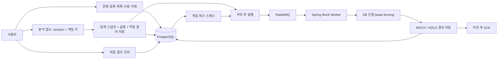

# 문제 라이브러리·분석 큐·법령 검색 기반

현재 구현은 문제 CRUD·Google 로그인/세션·기본 화면, Spring 개발 Mock 큐, 법령 import·PostgreSQL 검색 기반 및 실제 AI를 호출하는 LIVE 색인/검색 내부 service다. 공식 API 수집·실제 검수 코퍼스의 품질·실제 분석 워커/verify는 후속이다. Mock 완료나 검색 후보 반환은 법령 판정 성공을 의미하지 않는다.

## API와 접근

- 등록과 분석 접수는 별도 요청이다. 문제는 제공 정답·기준일·5선지를 보존한다.
- 제출 라이브러리: `GET /api/v1/questions?scope=mine&limit=20`. 공개 목록은 `scope=public`, 공개 승인 문제만 반환한다. 최근 분석 요약은 요청자 자신의 USER 실행만 표시한다.
- 목록 정렬은 `createdAt DESC, id DESC`. 커서는 HMAC 서명 및 범위·회원 연결을 검사한다. 서버 재시작 시 키가 바뀌므로 기존 커서는 400이며 목록 첫 페이지부터 다시 조회한다. 다중 인스턴스·장기 커서는 공유 키 정책 도입 후 지원한다.
- 수정/삭제는 본인과 `If-Match: "revision"`이 필요하다. 행 잠금과 revision 조건을 함께 적용한다. 수정 응답은 새 revision·ETag, 오래된 revision은 409, 헤더 누락은 428이다.
- 사용자 수정은 공식 검수 출처·공개 상태를 제거하고 PRIVATE/USER_INPUT/USER_PROVIDED로 전환한다. 원래 공식 데이터를 계속 공유하려면 별도의 관리자 재검수가 필요하다.
- 삭제는 soft delete다. 진행 중 작업을 취소하고 과거 실행 조회도 차단한다. 영구 삭제·보존 기간은 별도 정책이다.
- 분석·작업·결과 조회는 실행자 전용이다. 타인·삭제·존재하지 않는 자원은 404다. OAuth 전에는 local 고정 개발 회원 또는 테스트 principal로 검증한다. 클라이언트 회원 ID 헤더는 금지하고 CSRF를 유지한다.

## 작업 신뢰성

`trace_runs + processing_jobs`는 같은 트랜잭션에 생성한다. `(requester, TRACE_CREATE, Idempotency-Key)`가 유일하며 같은 질문/revision 재전송은 기존 식별자를 반환한다. 원래 입력 스냅샷은 이후 수정과 무관하게 보존한다.

아웃박스 테이블은 없다. durable exchange/queue, persistent 메시지 `{schemaVersion,jobId,requestId}`, publisher confirm 및 mandatory return을 사용한다. AFTER_COMMIT 발행 기록은 별도의 짧은 트랜잭션에서 저장한다. 브로커 장애가 접수된 작업을 삭제하지 않는다.

5초 복구 주기에서 미발행 PENDING, QUEUED 60초 경과, due RETRY_WAIT, lease 만료 RUNNING을 재발행한다. 중복 발행을 허용하고 DB 선점으로 실행을 제어한다. 한 번만 전달된다고 보장하지 않는다. 스캔당 100개를 처리하고 오래된 작업부터 선택한다.

lease 180초, heartbeat 30초, 접수 후 deadline 10분이다. 선점할 때 fencing token을 증가시킨다. 결과 저장은 현재 token·유효 lease·미취소·미삭제 조건을 모두 검사한다. 모든 경합 경로의 잠금 순서는 question → run → job이다. 늦은 발행 확인은 RUNNING/최종 상태를 덮지 않는다. 발행 시도 번호도 조건으로 검사해 이전 콜백이 새 기록을 덮지 못하게 한다.

단계 시도는 최초 포함 3회, 재시도 간격은 5초/20초에 최대 1초 jitter다. Retry-After가 더 늦으면 사용하되 deadline을 넘지 않는다. 완료 단계는 checkpoint로 건너뛴다. 기술 장애는 FAILED이며 HOLD로 숨기지 않는다. 현재 Mock은 PREPARE/SEARCH/VERIFY/PERSIST 흐름만 검증하고 검색·모델을 실제 호출하지 않는다. 결과는 `executionMode=MOCK`, `verdict=HOLD`, `reasonCode=MOCK_ONLY`, `evidences=[]`, `choiceAnalyses=null`이다.

## 저장 구조

| 버전 | 테이블 | 역할 |
|---|---|---|
| V001/V002 기존 | members, questions, question_choices, vector 확장 | 회원·문제·선지 |
| V003 | laws, law_versions, law_articles, law_chunks | 공급자 식별·시행 기간·불변 원문·연속 청크 |
| V004 | trace_runs, processing_jobs, evidence_results | 입력 스냅샷·멱등·작업 복구·근거 저장 자리 |
| V005 | law_chunk_indexes, question_embeddings | 모델/토큰 버전별 색인·질문 추천 벡터 저장 자리 |

기존 migration은 수정하지 않는다. Flyway가 V003→V004→V005 순으로 추가한다. 인증 세션·골든셋 저장·선지 분석 테이블은 이번에 생성하지 않는다.

`LawImportService`는 제한된 내부 service이며 공개 import HTTP가 없다. 같은 공급자 키/hash는 재사용하고 다른 hash나 VERIFIED 기간 겹침은 `SOURCE_CONFLICT`로 거절한다. 신규 법령 생성부터 advisory lock, 이후 법령 row lock으로 동시 수집을 직렬화한다. 원문을 덮어쓰지 않는다.

청킹은 `article-span-v1`: 검수자가 지정한 연속 조문 범위를 code point로 저장하고 조문 전체를 빈틈없이 덮도록 검사한다. 상위 제목/조건을 보강한 `searchText`와 실제 인용용 `sourceText`를 구분한다. 자동 법령 parser·모델 token 수에 따른 분할은 아직 없다. `SourceText.requireQuote`는 code point [start,end) 인용을 원문과 정확히 대조한다.

FIXTURE는 synthetic 표시와 별도 공급자다. VERIFIED fixture와 수작업 벡터 저장은 고립 test 프로파일에서만 허용한다. 공개 법령 API는 LAW_GO_KR + VERIFIED만 반환하고 rawPayload는 숨긴다. 출처 URL이 있다는 사실만으로 공식 수집·검수 완료라고 주장하지 않는다.

## 독립 검색 계산

`HybridSearchService`는 내부 Spring service다. 호출자가 고정 법령 ID·기준일·정확한 모델/tokenizer/chunker 버전·질의 벡터/토큰을 제공한다. `LiveRetrievalService`가 고정된 실제 Python HTTP 어댑터로 질의 토큰/벡터를 만들어 이 service를 호출하고 RRF 후보를 리랭크한다. 사용자 분석 Mock 큐와는 아직 연결하지 않았다.

1. 같은 법령 corpus의 VERIFIED `[effectiveFrom,effectiveTo)` 버전을 선택한다. 필요한 법령 버전이 없으면 `LAW_VERSION_UNAVAILABLE`이며 현재 법령으로 대체하지 않는다.
2. source hash와 chunker/model/tokenizer 버전, 채널 READY 상태를 검사한다. Mock fixture는 test 외 검색에서 제외한다.
3. 1024차원 유한·비영 벡터의 pgvector exact cosine `<=>` 오름차순으로 dense 30개를 찾는다.
4. 양쪽에 같은 토큰 처리 결과를 사용한다. `to_tsvector('simple', joinedTokens)`와 `plainto_tsquery('simple', joinedTokens)`의 AND 검색, `ts_rank_cd DESC`로 lexical 30개를 찾는다. 값은 파라미터로 바인딩한다. BM25나 임베딩 코사인 계산이라고 부르지 않는다.
5. 채널 안 chunk 중복 제거 후 `1/(60+rank)`를 합산하고 상위30을 반환한다. 같은 점수는 PostgreSQL UUID와 같은 문자열 오름차순이다. 빈 채널은 다른 채널로 진행한다. 오류를 빈 결과로 바꾸지 않는다.

초기에는 exact 검색과 GIN FTS를 사용한다. HNSW는 측정 후 신규 migration으로 검토한다. HyDE는 OFF 기준이다. 내부 검색 경로는 rerank까지이며 실제 verify·최종 판정은 아직 없다.

`FixtureIndexWriter`는 test + FIXTURE 공급자 + fixture revision을 모두 요구한다. `LiveLawIndexService`는 LAW_GO_KR + VERIFIED 원문만 받고 고정 실제 모델/토큰 버전으로 한 청크씩 색인한다. HTTP는 트랜잭션 밖에서 호출하고 원문을 재검사한 짧은 저장 트랜잭션에서 두 채널을 원자 READY로 만든다. 실패 시 반쪽 READY를 만들지 않으며 같은 입력 재호출은 완성 행을 재사용한다. 실제/Mock 구분은 readiness의 backend 이름과 승인 pin으로 검사하며 접두사만 사용하지 않는다.

`LiveIndexStore`는 명시 법령/기준일의 전체 조문·청크 범위, source/검색문 hash, chunker·model·tokenizer와 모든 색인의 READY를 확인한다. 미확보 버전과 미완료 색인을 검색 0건으로 숨기지 않는다. 원문·버전·색인 ID/갱신 시각을 포함한 manifest를 검색 전, 질의 추론 후 DB snapshot 안, rerank 후 재검사한다. 변경 시 결과를 거절한다. 이 manifest는 현재 범위의 재현 fingerprint이며 별도 영구 corpus manifest 등록/승인 시스템을 구현한 것은 아니다. source/parser 자체의 정확성 검수는 별도다.

검색 결과는 `verificationPerformed=false`이며 SUPPORTED/HOLD/REJECTED를 생성하지 않는다. rerank 후보 수1~30과 topK1~5는 내부 호출자가 명시하고 실제 전송 후보 수도 결과에 남긴다. CPU 초기 검수는 소량부터 하며 이 내부 예산을 양쪽 최종 성능 계약으로 표시하지 않는다. `question_embeddings`는 추천용 저장 기반이며 이번 질의 캐시로 사용하지 않는다. [실행·검수](../runbooks/live-retrieval.md)를 참고한다.

평가 계산은 사람이 준 기대 조문과 순위를 article 단위로 중복 제거한 top5로 대조한다. Recall은 사례별 비율 평균, Hit는 하나 이상 일치 비율이다. 정답 조문 없는 HOLD는 검색 분모에서 제외하고 판정 분모에는 포함한다. 기술 실패는 0점, 빈 셋은 null, Mock은 실제 평가에서 제외한다. 골든셋 저장/사람 라벨·실제 품질 비교는 미완료다.
