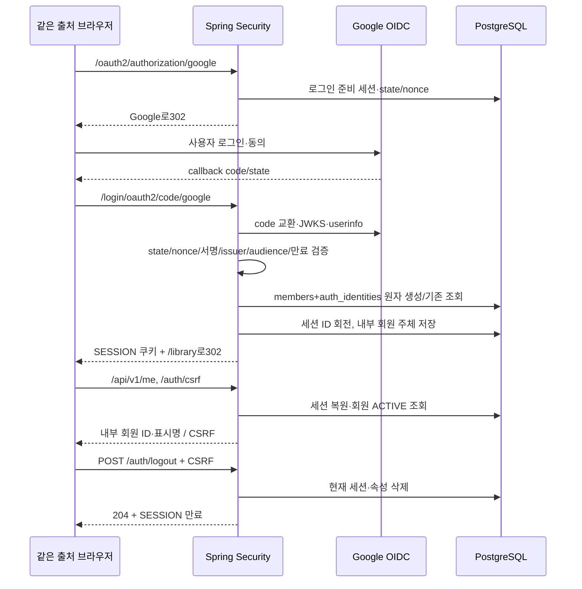

# 인증과 세션 데이터 흐름

검증된 (GOOGLE,issuer,subject)만 계정 식별에 사용한다. Google issuer 표기를 정규화하며 이메일은 DB 식별자/자동 병합 키로 쓰지 않는다. 같은 identity 동시 첫 로그인은 UNIQUE 충돌 트랜잭션을 전체 rollback한 뒤 기존 계정을 조회해 고아 회원을 남기지 않는다. MemberResolver는 기존 보호 API의 내부 UUID/ACTIVE 검사를 유지한다.

V006은 auth_identities와 공식 Spring Session JDBC3.5.7 PostgreSQL 테이블을 추가한다. 세션에는 내부 MemberPrincipal(memberId,authenticatedAt)과 ROLE_USER, 프레임워크 CSRF/일시적 로그인 준비만 둔다. 로그인 뒤 Google ID/access/refresh token·이메일·profile claims를 세션에 저장하지 않는다. authorized-client 저장소는 토큰을 보관하지 않는다. 회원 표시명은80 code points 이하로 정리한다.

SESSION 쿠키는 Path=/, HttpOnly, SameSite=Lax, Domain 없음이다. prod 등 비local/test 환경에서는 Secure. idle30분은 JDBC expiry, absolute12시간은 내부 인증 시각으로 요청마다 검사한다. 만료는 익명 전환해 보호 API JSON401, 비활성 회원은 세션 폐기+403. cleanup은 매분 만료 행/연결 속성을 정리한다. 현재 세션 로그아웃은 접수된 분석을 취소하지 않는다.

CSRF는 로그인 성공 시 폐기하고 이후 GET /auth/csrf로 새 토큰을 받는다. 쓰기와 POST 로그아웃에 토큰이 필요하다. 임의 returnUrl·요청 캐시 redirect는 사용하지 않고 성공/실패 목적지는 고정한다. 인증된 API/CSRF/내 정보는 no-store로 처리한다. 프런트401 처리·계정 전환 화면은 후속 통합에서 검증한다.

키가 없는 환경에서는 OIDC 플래그를 켜지 않고 기존 local dev-auth를 별도로 사용한다. 둘을 동시에 켜거나 prod에서 dev-auth를 켜면 실패한다. Google 실제 로그인은 승인 Client/URI와 별도 실계정 검증이 필요하다. 테스트 공급자는 테스트 소스에만 있고 런타임 설정으로 선택할 수 없다.

공식 근거: [Spring Security6.5 OIDC 구성](https://docs.spring.io/spring-security/reference/6.5/servlet/oauth2/login/advanced.html), [CSRF](https://docs.spring.io/spring-security/reference/6.5/servlet/exploits/csrf.html), [Spring Session JDBC](https://docs.spring.io/spring-session/reference/configuration/jdbc.html). 실제 DDL은 선택된3.5.7 artifact와 테스트로 대조한다.
