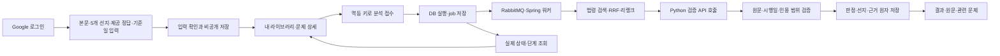

# LawGround 구현 보고서 — 윤영주

기준: 2026-10-26 · 공유 일정 통합8주차까지(원본9주차, V009 포함) · 작성 범위: Spring/DB/사용자 화면 및 서비스 연결.

## 1. 이번 범위에서 달성한 것

사용자의 문제 입력을 개인 라이브러리에 저장하고, 분석 요청을 내구성 있는 큐 작업으로 처리하여 선지별 설명과 검증된 인용 근거를 돌려주는 Spring 경로를 구성했다. 기본 추천, 격리된 골든셋 평가, 승인 기출 배치 실행·집계도 연결했다. 로그인·DB·큐·브라우저의 실제 연동과 합성 추론 응답을 사용한 검사를 구분한다.

**이 보고서는 윤영주의 구현 보고서다.** Python 모델 서버 구현을 본인 성과에 포함하지 않는다. Python의 실제 `/verify` 모델 수용 검사, 실제 법령·기출 자료 검수, 태그 사전과 최종 품질 실험은 별도 준비가 필요하다. 분석 UI와 기출 배치는 기본 비활성이며 설정만으로 실제 AI 품질 완료를 선언하지 않는다.

## 2. 사용자가 이용하는 흐름

로그인은 Google OIDC와 JDBC 세션을 사용한다. 제공 정답은 시험지·교재의 정답이며 사용자가 고른 답이 아니다. 기준일은 화면에서 오늘 날짜를 미리 채우되 사용자가 확인·변경하고, 서버에는 필수 날짜로 전달한다. 과거 문제를 현행 법령으로 자동 치환하지 않는다.

접수 결과를 받기 전에 통신이 끊겨도 같은 요청 키를 사용해 중복 생성을 막는다. 새로고침하면 실행 ID로 실제 job 단계를 다시 조회한다. 화면 이동 후에도 서버 작업은 이어진다. 결과는 실행 당시 문제 snapshot을 보여주므로 수정한 현재 문제와 혼동하지 않는다.

| 사용자에게 보이는 상태 | 서버에서 의미하는 것 |
|---|---|
| 분석 대기·처리 중 | 실제 job/trace 상태와 처리 단계 |
| 근거 확인 / 정답과 근거 불일치 / 판단 보류 | SUPPORTED / REJECTED / HOLD 정상 판정 |
| 분석 실패·취소 | 기술 실패 또는 CANCELLED. 법률 판정으로 표시하지 않음 |
| 선지별 설명 미제공 | 선택적 설명 데이터가 없음. 임의 해설을 채우지 않음 |
| 관련 문제 없음 | 접근 가능한 실제 추천 후보가 없음 |

선지와 조문의 관계는 ‘일치·불일치·근거 부족’으로 표시한다. 정정문은 불일치 선지에 실제 근거가 연결된 경우만 표시한다. 제공 정답 번호와 개별 선지의 조문 일치 여부를 구분한다. 선택률·오답률·가짜 완료율은 표시하지 않는다.

## 3. 담당 구현과 근거

| 영역 | 윤영주가 구현한 내용 | 기존 병합 근거 |
|---|---|---|
| 계약·기반 | Java21/Spring Boot3, 디렉터리·의존성, 입력/오류/응답 규칙, OpenAPI, CI | [PR3](https://github.com/lawground-team/LawGround/pull/3) |
| 문제 관리·검색 기반 | 5선지 CRUD, revision/If-Match, 계정별 라이브러리, Mock 큐와 복구, 법령·벡터/단어 검색 기반 | [PR10](https://github.com/lawground-team/LawGround/pull/10) |
| 인증·기본 화면 | Google OIDC, 회원 연결·JDBC 세션·CSRF·로그아웃, 실제 DB CRUD 화면 | [PR14](https://github.com/lawground-team/LawGround/pull/14) |
| 실제 AI HTTP 연결 | 고정 모델 revision/readiness, 법령 색인, PostgreSQL pgvector·단어 검색·RRF와 리랭크 호출 | [PR17](https://github.com/lawground-team/LawGround/pull/17) |
| LIVE 워커 | 실제 검색 파이프라인을 큐와 연결, 단계 checkpoint·리스·fencing·재시도·복구 | [PR19](https://github.com/lawground-team/LawGround/pull/19) |
| 검증 결과 저장 | `/verify` 호출·계약 검증, 원문/offset/시행일/근거 대조, 원자 결과 저장 | [PR21](https://github.com/lawground-team/LawGround/pull/21) |
| 골든셋 평가 | 검수 라벨 고정, DEV/FINAL 누수 검사, 격리된 평가 실행과 실패 포함 지표 | [PR23](https://github.com/lawground-team/LawGround/pull/23) |
| 기본 추천 | 근거 조문·문제 임베딩 기반 실제 후보 조회, 시행일·권한·revision 필터 | [PR25](https://github.com/lawground-team/LawGround/pull/25) |
| 선지별 분석 | 선택적 5선지 응답 검증·원자 저장, evidence UUID 연결, 정정문·태그 경계 | [PR27](https://github.com/lawground-team/LawGround/pull/27) |
| 이번 보완 | 분석/대기/결과/추천 화면 통합, 브라우저 회귀, 공개 기출 분석 권한 연결 | [이슈28](https://github.com/lawground-team/LawGround/issues/28) |
| 통합8주차 | V009 승인 기출 배치 실행·재개·분모를 보존한 집계, 본 보고서 | [이슈29](https://github.com/lawground-team/LawGround/issues/29) |

위 PR의 병합 상태는 작성 시 GitHub에서 조회했다. 이슈28·29는 이번 변경의 추적 항목이며, 로컬 구현/검수·PR 게시·원격 CI·병합은 별도 상태로 관리한다. 주차는 작업 묶음이며 미리 구현한 기능의 달력 날짜를 주차 일정에 맞추어 바꾸지 않는다.

## 4. DB와 기능의 연결

V009 적용 후 제품 테이블은 업무22개와 세션2개, 총24개다. Flyway 이력 테이블은 제품 테이블 수에서 제외한다.

| 테이블 묶음 | 저장하는 사실과 사용 기능 |
|---|---|
| members, auth_identities, spring_session* | 회원·Google 식별자·세션. 로그인, 계정 격리, 재로그인 |
| questions, question_choices | 본문·5선지·제공 정답·기준일·소유자·revision. CRUD/개인 라이브러리 |
| laws, law_versions, law_articles, law_chunks | 공식 출처 메타데이터와 시행일·원문·청크. 기준일에 맞는 근거 조회 |
| law_chunk_indexes, question_embeddings | 검색용 벡터·토큰/색인 상태·모델 버전. Hybrid 검색과 추천 |
| trace_runs, processing_jobs | 고정 입력·설정·판정과 처리 단계·리스·재시도·종료 상태. 큐 작업과 상태 복구 |
| evidence_results, choice_analyses, choice_analysis_evidences | 검증된 인용과 원래 선지·관계·설명·근거 연결. 결과 화면 |
| golden_sets, golden_cases, golden_case_evidences | 사람이 검수한 평가 입력·기대 판정·기대 조문. 평가 기준 고정 |
| evaluation_runs, evaluation_results | 실행별 버전·개별 성공/실패·평가 지표. USER 데이터와 격리 |
| batch_runs, batch_items | 승인 기출 묶음·고정 계획·개별 상태·최종 집계. BATCH 데이터와 재개 |

PostgreSQL은 업무 데이터와 정확한 권한·트랜잭션을 관리한다. pgvector는 PostgreSQL 내부의 검색용 벡터 연산을 제공한다. 단어 검색은 토큰 기반 SQL이고 임베딩 코사인 검색과 다르다. RRF는 두 검색의 순위를 합치며, 리랭크는 Python 점수 응답을 계약에 맞게 검증하고 후보 순서를 재정렬한다. 법령 원문을 다시 학습시키는 작업과 DB 저장/검색을 혼동하지 않는다.

## 5. 승인 기출 배치와 집계

운영자가 승인한 PUBLIC/EXAM_IMPORT/OFFICIAL_VERIFIED 문제를 선택하면 문제별 snapshot·revision·기준일과 법령/모델/코드 버전을 고정한다. 같은 요청 키로 다시 시작해도 기존 배치와 job을 반환한다. 기존 워커가 BATCH 범위로 처리하고 `refresh`가 종료된 항목을 한 번만 반영한다. 작업 중 공개 승인이 철회되거나 원문 revision·실행 코드가 바뀌면 뒤늦은 저장을 차단한다.

전체 문제 수 = 성공 + 실패 + 대기다. 전체 선지 수 = 분류됨 + 미분류 + 미처리다. 현재 태그 사전은 미확정이므로 성공 항목도 미분류로 남긴다. 선지 설명이 없는 경우에는 설명 미제공 건수를 따로 남긴다. 이 값은 사용자 오답률이 아니다.

예를 들어 3문제 중 성공1·실패1·대기1이면 전체 선지15, 미분류5, 미처리10이다. 성공 응답에 선지 설명도 없다면 설명 미제공5가 추가로 기록된다. 이를 미분류5와 더해20으로 계산하지 않는다. 같은 조문을 여러 차례 인용해도 조문별 문제 건수는 문제당 한 번만 센다.

세부 운영 방식은 [배치 실행 안내](../runbooks/exam-batches.md)를 따른다. 공개 관리자 API, 미확정 태그 분류, 실제 데이터 수집 완료를 이번 기능에 포함하지 않는다.

## 6. 검수 방법과 재현 범위

| 검사 | 확인하는 내용 | 확인하지 않는 것 |
|---|---|---|
| Gradle `clean check bootJar` | 포맷·단위·임시 실제 PG/pgvector/RabbitMQ 통합·패키징 | 실제 법률 판정 정확도 |
| Node frontend 검사 | 구문·입력·CSRF·멱등/계정 전환·결과 표시 규칙 | 실제 브라우저 레이아웃 전체 |
| Playwright `frontendE2E` | 서명된 테스트 OIDC → 실제 세션/DB 저장 → 큐 → 선지·근거·추천 → 취소·로그아웃·타 계정 차단, 모바일 넘침 | Google 운영자 서비스·실제 LLM 품질 |
| OpenAPI/실제 응답 검사 | 명세·예제·실패 사례와 통합 테스트 응답의 일치 | 의미상 법률 정답 여부 |
| V008→V009 업그레이드 | 기존 checksum·회원 데이터 보존, 새 배치 테이블 생성 | 운영 DB 백업/복구 실연 |

전체 검사 결과는 해당 PR의 같은 commit CI와 `backend-test-reports`, `browser-workflow-evidence` 아티팩트로 확인한다. 브라우저 캡처는 합성 문제·법령을 사용한다. 이전 commit 테스트 수치나 성공한 일부 표본을 전체 서비스 품질로 표시하지 않는다. 로컬 확인용 보고서에는 실제 실행 결과·화면 캡처를 함께 제공한다.

재현 명령은 [분석 화면 검사](../runbooks/analysis-ui.md), [배치 검사](../runbooks/exam-batches.md), [평가 실행](../runbooks/evaluation.md), [API 계약](../api/external-api.md)을 참고한다.

## 7. 남아 있는 수용 조건

1. 실제 `/verify` 서버와 고정 모델·프롬프트가 준비된 뒤 사용자 문제→최종 결과의 실제 추론 수용 검사.
2. 공식 법령·기출의 수집/이용 조건과 기준일 검수, 사람이 검수한 골든 라벨 확보. 합성 자료를 공식 기출·평가 성적으로 발표하지 않기.
3. 태그 사전·버전·분류 기준 합의 후 유형 집계 구현/검수. 현재 미분류 표기는 그대로 유지.
4. 동일 평가셋/환경에서 검색·HyDE·리랭크 비교와 p50/p95·비용 측정. 이번 보고서에는 미측정 성능 수치가 없다.
5. 클라우드 서버 생성·배포 환경 확정·비밀값 주입·모니터링/백업·운영 수용 검사. 로컬 통과를 배포 완료로 표시하지 않기.

캡처/OCR·카메라·단일 선지 분석은 핵심 범위 뒤의 확장이다. Notion 일정표 변경은 보류하며 이번 구현과 보고서를 일괄 반영할 때 완료 근거가 있는 항목만 체크한다.
